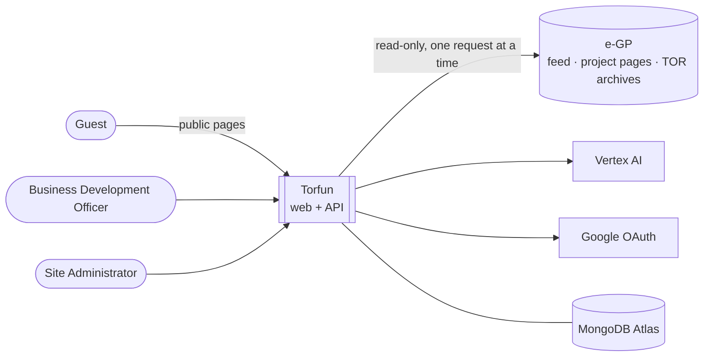

# Software Requirements Specification for Torfun

|             |                                                                                         |
| ----------- | --------------------------------------------------------------------------------------- |
| **Version** | 0.3 — team SRS of 30 August 2026, with implementation status and reconciliation changes |
| **Status**  | Draft for review                                                                        |
| **Baseline for status** | `develop` @ `5e622a3`                                                       |
| **Related** | [system-requirements.md](system-requirements.md) (technical requirements derived from the code) · [architecture.md](architecture.md) · [data-model.md](data-model.md) · [`CONTEXT.md`](../CONTEXT.md) |

> **About this revision.** Sections 1–5 and Appendices A–B are the team's SRS
> (30 August 2026), with the same requirement IDs. Version 0.3 adds:
>
> - a **Status** column on each requirement (✅ Implemented · 🟡 Partial ·
>   ⏳ Planned · ↔ Deviates · ❔ Not verified), judged against the code on the baseline commit;
> - **reconciliation edits**: wording changed where the code made a different,
>   deliberate choice. Each edit is tagged inline as **🔄 Changed (D-nn)**, and the
>   original wording is kept in §6.2 so nothing is lost;
> - **Section 6**, which records every deviation, whether it was **applied** or is
>   still **open** for a team decision.
>
> Text tagged **🔄** was changed by the document editor to match the built system
> and is **pending team confirmation**. Items tagged **⚠ Open** were not changed:
> they are product decisions (D-05, D-07, D-08).

## Table of contents

1. [Introduction](#1-introduction)
2. [Overall Description](#2-overall-description)
3. [User Stories](#3-user-stories)
4. [System Features and Functional Requirements](#4-system-features-and-functional-requirements)
5. [Nonfunctional Requirements](#5-nonfunctional-requirements)
6. [Implementation Status and Deviations](#6-implementation-status-and-deviations) (decision log: §6.2)
7. [Traceability](#7-traceability)
- [Appendix A: Target government agencies](#appendix-a-target-government-agencies)
- [Appendix B: Glossary](#appendix-b-glossary)

---

## 1. Introduction

### 1.1 Purpose

This Software Requirements Specification (SRS) provides a description of Torfun,
an AI-assisted procurement intelligence platform for software-related Terms of
Reference (TOR) announcements published by Thai government agencies. It details
the functional and non-functional requirements for a platform that reduces the
manual effort of locating, reading and qualifying procurement opportunities by
automating collection, extraction, filtering and summarisation of TOR documents.

At present, Business Development Officers visit multiple government procurement
portals individually and read TOR documents page by page to decide whether the
company is qualified to bid. This consumes significant working hours, risks
missed opportunities, and produces inconsistent qualification decisions across
officers. Torfun consolidates announcements into a single searchable interface,
extracts key attributes from TOR files, and scores each opportunity against the
company profile.

### 1.2 Document Conventions

| Term       | Definition |
| ---------- | ---------- |
| **SHALL**  | Mandatory requirement; must be fulfilled in the current implementation phase. |
| **SHOULD** | Recommended requirement; there may be valid reasons to ignore it. |
| **MAY**    | Optional requirement; grants the developer flexibility or describes extra functionality. |
| **TBD**    | To be determined; not yet available, to be provided in a future version. |
| **Note**   | Additional information or clarification. |

| Requirement number | Description |
| ------------------ | ----------- |
| US-XX  | User Stories |
| FR-XX  | Functional Requirements |
| NFR-XX | Non-Functional Requirements |

### 1.3 Scope

Torfun is an AI-assisted procurement intelligence platform that consolidates
software-related TOR announcements issued by a controlled set of Thai government
agencies. The platform reads the e-GP announcement feed for e-bidding tenders
published by those agencies, uses the project identifier to obtain the
corresponding project detail, announcement timeline and TOR attachment from the
e-GP system, extracts key attributes from the document, and scores each
opportunity against the company profile. It serves as a working interface
between Business Development Officers and dispersed public procurement sources,
replacing manual portal-by-portal inspection with a single ranked and filterable
view. 🔄 *Changed (D-01): the source was "the Thailand Government Spending open
data service".*

> **⚠ Open (D-05).** "a single company profile" is unchanged, but the built system
> keeps a Company per vendor made of Clients and Experience. See §6.2.

**In scope**

- **Announcement Ingestion** — a scheduled retrieval process that reads the e-GP announcement feed (draft TOR and invitation announcements for e-bidding), filters records to the agencies in the Source Registry (Appendix A), and uses each project identifier to retrieve announcement details and attached TOR files from e-GP. Records are deduplicated by project identifier; retrieval failures are logged for administrator review. 🔄 *Changed (D-01): was "queries the Thailand Government Spending open data API".*
- **Document Extraction** — a pipeline in which Vertex AI reads each TOR file directly, including scanned Thai documents, and derives structured attributes: budget, submission deadline, technology stack, target platform and industry sector. 🔄 *Changed (D-04): was "extracts text … applies OCR".*
- **Company Profile and Matching** — a single organisation-wide profile (past project industries, technology expertise, project size range, target platforms, years of experience). Each announcement is assigned a matching score against it; scores are recomputed when the profile changes.
- **Search, Filtering and Dashboard** — a ranked view of recommended announcements, filterable by budget range, publication date, submission deadline, technology stack, industry sector and target platform.
- **TOR Review** — in-browser display of the AI summary alongside access to the original source document, both for reading in the platform and for download.
- **Email Notification** — automated email and in-application alerts when a newly ingested announcement exceeds the configured matching-score threshold or a saved TOR's status changes.
- **Identity and Access Management** — role-based access control with two roles, Business Development Officer and Site Administrator. Authentication is by username and password, or Google OAuth (FR-03). 🔄 *Changed (D-12): was "TBD".*
- **Administration** — administrator control over the Source Registry, ingestion schedule, company profile and user accounts.

**Out of scope for this phase**

- **General web crawling** — targeted retrieval by known project identifier only; no link discovery, site traversal, or ingestion from sources outside the Source Registry.
- **Non-software and out-of-registry announcements** — excluded regardless of relevance.
- **Bid preparation and submission** — the platform supports the decision whether to pursue an opportunity; it does not generate proposals, pricing or bid documents, and does not submit bids.
- **Third-party TOR publication** — all content originates from government sources.
- **Mobile application development** — optimised for desktop browsers; no native iOS/Android apps.
- **AI model training** — pre-trained Vertex AI only; nothing is trained, fine-tuned or hosted.
- **Alternative notification channels** — no LINE, SMS or any channel other than email and in-application.
- **Per-user profiles** — one shared company profile; no individual profiles or multi-tenant operation. **⚠ Open (D-05):** the built system has one Company per vendor, so this exclusion does not describe it.
- **Payment processing** — internal tool; no payment gateway or subscription management.

---

## 2. Overall Description

### 2.1 Product Perspective

Torfun is a web-based procurement opportunity management system that helps users
discover and evaluate software-related government procurement opportunities in
Thailand, without manually searching multiple procurement websites.

The platform interfaces with:

- **External procurement websites** — collects project title, organisation, budget, procurement method, announcement date, deadline, TOR information and source URL from supported Thai government procurement sources.
- **AI service (Google Vertex AI)** — classifies whether a project is software-related and relevant. AI results are recommendations and do not replace official procurement information.
- **Database service (MongoDB Atlas)** — stores users, procurement records, classification results, saved TORs, recommendations and other application data.
- **Authentication provider** — manages identity and secures user-specific features. Credentials and sensitive information shall not be stored in plaintext.
- **Official procurement sources** — Torfun maintains links to the original sources so users can verify information and access the official TOR before deciding to participate.

The detailed architecture is in [architecture.md](architecture.md).

### 2.2 User Classes and Characteristics

**1) Guest (unauthenticated user).** Visitors who have not signed in. They SHALL
be able to access publicly available procurement information and general system
pages. They SHALL NOT have access to user-specific features such as Dashboard
personalisation, My TOR, saved opportunities or personalised recommendations.
The system SHALL redirect them to login when they attempt to access a protected
feature.

**2) Authenticated User.** Fully authenticated users and the primary users of
Torfun. They SHALL have the full set of user-facing features: search, filtering,
dashboard, recommendations, procurement details and My TOR. They SHALL be able to
search and filter, view detailed TOR information, save and remove TORs, manage
preferences where supported, receive recommendations and notifications, and
reach the original procurement source for manual evaluation.

**3) System Administrator.** Authorised personnel who maintain and monitor the
platform. They SHALL have administrative functions unavailable to regular users:
monitor crawler operations, manage supported procurement sources, review
crawling errors, manage system configuration and monitor platform health.

> **Note.** In the code the roles are `business_development_officer` and `admin`
> (the two roles of FR-02). "Guest" is the absence of a session. Self-registration
> always creates a BD Officer; `admin` is granted in the database, never claimed.

### 2.3 Assumptions and Dependencies

**Assumptions**

1. **Stable procurement source availability** — supported Thai government procurement websites remain accessible; structure changes or outages may affect data collection.
2. **Standardised browser environment** — modern browsers (Chrome, Firefox, Safari, Edge) with HTML5, JavaScript and HTTPS.
3. **External AI service availability** — Vertex AI remains accessible and its quota and rate limits suffice for expected volume.
4. **Procurement data consistency** — the structure and content of source data stay consistent enough for the crawler and extraction to operate.
5. **Internet connectivity** — users keep a stable connection; offline operation is not supported.
6. **User technical proficiency** — users have basic digital literacy.
7. **Official source verification** — users verify requirements, deadlines and eligibility at the official source before applying.
8. **Supported procurement sources** — only explicitly configured sources are collected; arbitrary websites are not supported.

**Dependencies**

1. **External procurement websites** — endpoint, structure, availability, access policy or format changes may affect ingestion.
2. **Generative AI service (Vertex AI)** — latency, downtime, quota or model-behaviour changes are outside Torfun's control.
3. **Database service (MongoDB Atlas)** — disruptions affect all persisted functions.
4. **Authentication service** — an outage may prevent access to protected features.
5. **Cloud infrastructure and connectivity** — frontend, backend, database, sources and AI services must be reachable.
6. **Development frameworks** — Next.js, Node.js, MongoDB and open-source libraries; breaking changes may require rework.
7. **Third-party service policies** — terms, access policies, rate limits or restrictions of procurement websites and providers.

> 🔄 **Changed (D-09).** The backend runs on **Bun** (Fastify 5) rather than Node.js; the
> frontend is Next.js 16. Constraints C-01 and C-02 below were added.

### 2.4 Constraints 🔄 *Added (D-06, D-09)*

| ID | Constraint |
| -- | ---------- |
| C-01 | **Upstream access is conditional.** e-GP's `robots.txt` disallows crawling; Torfun reads it under a research authorisation. The system SHALL send one request at a time with a pause after each, SHALL stop for the rest of a run on a rate-limit or forbidden response, and SHALL NOT call the protected project search, solve captchas or use a headless browser. The authorisation's limits are not recorded in the repository (⚠ Open: record or link them). |
| C-02 | **TOR documents are not stored.** Archives are held in memory only while analysed; viewing or downloading a TOR re-fetches it from e-GP, so those functions depend on e-GP being reachable. |
| C-03 | **AI output is a summary, never an authority.** The original document SHALL remain reachable from every analysed record. |

---

## 3. User Stories

Status reflects whether the story can be completed end to end in the built system.

| ID | User story | Status |
| -- | ---------- | ------ |
| US-01 | As a BD Officer, I want the system to automatically collect procurement announcements, so that I don't need to visit every website manually and can reduce screening time. | ✅ |
| US-02 | As a BD Officer, I want the system to provide me only software TOR, so that I don't waste time reading unrelated TORs. | ✅ |
| US-03 | As a BD Officer, I want to filter out unrelated projects by budget, published date, deadline, tech stack, industry (e.g. hospital, school), decision rules (e.g. price), target platform (macOS, Windows, mobile, web-app) and location, so that I can narrow down opportunities. | 🟡 all but decision rules and location; industry is a keyword match |
| US-04 | As a BD Officer, I want to search for TORs using keywords, so that I can quickly find projects related to my business. | ✅ |
| US-05 | As a BD Officer, I want to see full details and the AI summary of the selected procurement, so that I can quickly understand the important details before reading the full document. | ✅ |
| US-06 | As a BD Officer, I want to download the original TOR document, so that I can verify the project details and validate whether it is worthwhile. | ✅ |
| US-07 | As a BD Officer, I want to view the original TOR document from the system, so that I can verify details without always downloading. | ✅ |
| US-08 | As a BD Officer, I want the system to compare my company's qualifications with the TOR requirements, so that I can determine whether my company is suitable. | ⏳ |
| US-09 | As a BD Officer, I want to compare a TOR's budget with budgets of similar previous projects, so that I can judge whether the budget is reasonable. | ⏳ |
| US-10 | As a BD Officer, I want to save interesting TORs to my personal list, so that I can review them later. | ✅ |
| US-11 | As a BD Officer, I want in-system notifications when a TOR matches my qualifications or on other relevant events (e.g. status change), so that I don't miss opportunities. | ⏳ |
| US-12 | As a BD Officer, I want email when a TOR matches my qualifications or seems interesting, so that I need not always open the system. | ⏳ |
| US-13 | As a BD Officer, I want to select which events notify me, in the system and by email, so that I don't receive junk notifications. | ⏳ |
| US-14 | As a BD Officer, I want to report a TOR I find unreasonable, so that the Site Administrator can decide whether it should remain published. | ✅ |
| US-15 | As a Site Administrator, I want to manage the crawling schedule, so that TOR information stays up to date. | ✅ |
| US-16 | As a Site Administrator, I want alerts when the system detects an unusual or potentially invalid TOR, so that I can approve or reject it. | 🟡 held records appear in an approval queue; there is no push alert |
| US-17 | As a Site Administrator, I want to monitor the status of TOR data collection, so that I can identify failed or incomplete collection. | ✅ |
| US-18 | As a Site Administrator, I want to view the processing status of each collected TOR, so that I can track whether it is processed correctly and find errors. | ✅ |
| US-19 | As a Site Administrator, I want to manage authenticated user accounts, so that only authorised users can access the system. | 🟡 list, activate and deactivate only |
| US-20 | As a Site Administrator, I want to remove published TORs found invalid or outdated, so that the platform stays accurate. | ✅ |
| US-21 | As a Site Administrator, I want to monitor user reports such as outdated TOR status, so that the platform stays accurate. | ✅ |
| US-22 | As a Site Administrator, I want to edit my admin profile and password, so that the platform stays accurate. | ❔ no endpoint found |
| US-23 | As a Site Administrator, I want to manage system settings, so that I can control and maintain the system's operation. | 🟡 ingestion schedule only |

---

## 4. System Features and Functional Requirements

### 4.1 Identity and Access Management

| ID | Requirement | Status | Note |
| -- | ----------- | ------ | ---- |
| FR-01 | The system SHALL restrict the Dashboard, My TOR, and all personalized features to Authenticated Users; Guests attempting to access a protected feature SHALL be redirected to login. | ✅ | Server components call `requireUser()` / `requireAdmin()` and redirect. |
| FR-02 | The system SHALL support two roles — Business Development Officer and Site Administrator — with role-based access control enforced on every protected route and API endpoint. | ✅ | `requireAuth` / `requireAdmin` hooks per route scope. |
| FR-03 | The authentication mechanism SHALL support both username/password and Google OAuth. | ✅ | |
| FR-04 | The authentication mechanism SHALL also provide a mechanism to add themselves to any company and be able to create one if it does not exist. | ✅ | Company typeahead, join and create (`/companies`). |
| FR-05 | The system SHALL provide a Sign Out function that invalidates the current session. | ✅ | Clears cookies and revokes the refresh-token family. |
| FR-06 | Site Administrators SHALL be able to create, suspend, and remove Authenticated User accounts. | 🟡 | **⚠ Open (D-07).** List and activate/deactivate (suspend) exist. Create-by-admin and remove do not. |
| FR-07 | Site Administrators SHALL be able to edit their own profile and credentials. | ❔ | No profile or password-change route found on `develop`. A `feature/account-settings` branch exists. |

### 4.2 Announcement Ingestion

| ID | Requirement | Status | Note |
| -- | ----------- | ------ | ---- |
| FR-08 | The system SHALL run a scheduled retrieval process against the e-GP announcement feed, at an interval an administrator configures (every 6 to 168 hours, or chosen weekdays at a time of day); the schedule SHALL be off until an administrator enables it. 🔄 *Changed (D-01, D-02): was "…against the Thailand Government Spending open data EGP-CONTRACT API, defaulting to every 24 hours."* | ✅ | Feed discovery is built. The open-data API is kept only for a future winner lookup. |
| FR-09 | The system SHALL filter retrieved records to agencies listed in the Source Registry (Appendix A). | ✅ | The five agencies of Appendix A are `SOURCE_REGISTRY` / `FEED_REGISTRY` in code. |
| FR-10 | For each admitted e-bidding record, the system SHALL use the project identifier to retrieve the project detail, announcement timeline and TOR attachment from the e-GP system; whether the work is software SHALL be decided from the TOR document, never from the project title. 🔄 *Changed (D-03): was "For each software related record…".* | ✅ | One gate turn per project. |
| FR-11 | The system SHALL deduplicate ingested records by project identifier. | ✅ | `projectId` is the key. |
| FR-12 | The system SHALL log retrieval failures for Site Administrator review. | ✅ | Failure log with stage and kind. |
| FR-13 | Site Administrators SHALL be able to view the processing state of each announcement across the retrieval, extraction and classification stages. | ✅ | `state` and `outcome`, plus a per-record status history. |

### 4.3 Document Extraction and AI Classification

| ID | Requirement | Status | Note |
| -- | ----------- | ------ | ---- |
| FR-14 | The system SHALL alert the Site Administrator when an announcement is flagged as unusual or potentially invalid. | 🟡 | Flagged records are held (`needs_review`) with a reason and surface in the admin approval queue and dashboard. No push or email alert. |
| FR-15 | The system SHALL read the content of ingested TOR files. 🔄 *Changed (D-04): was "extract text from ingested TOR files".* | ✅ | The PDF is given to Gemini directly; oversize files fall back to text or first pages (and are then held for review). |
| FR-16 | The system SHALL be able to read scanned Thai-language TOR documents that lack extractable text, and SHALL mark a document it cannot read as unreadable. 🔄 *Changed (D-04): was "apply OCR…".* | ✅ | The model reads the PDF natively; no separate OCR stage. |
| FR-17 | The system SHALL use Vertex AI to classify whether an announcement is software-related; non-software announcements SHALL be excluded from user-facing results. | ✅ | `isSoftware` + confidence; only high-confidence software is shown. Low confidence is held for an administrator. Not-software with high confidence is dropped and tombstoned. |
| FR-18 | The system SHALL use Vertex AI to derive structured attributes: budget, submission deadline, technology stack, target platform, industry sector. | 🟡 | Budget, deadline, duration, tech stack, target platforms, scope and qualifications are extracted. **Industry sector is not extracted**; the `industry` filter is a keyword match on project and agency names. |
| FR-19 | The system SHALL generate an AI summary for each TOR. | ✅ | |
| FR-20 | AI-generated classifications and summaries SHALL be visually labeled as recommendations, not authoritative source data. | ✅ | The review page states the content is read by AI from the TOR and should be checked against the original. |

### 4.4 Company Profile and Matching

| ID | Requirement | Status | Note |
| -- | ----------- | ------ | ---- |
| FR-21 | The system SHALL maintain a single, organization-wide Company Profile (industries, technology expertise, project size range, target platforms, years of experience). | ↔ | **⚠ Open (D-05).** Built as a **Company** per vendor, made of **Clients** and **Experience** records (tech stack, target platforms, duration). Not one shared profile; no "industries", "size range" or "years" fields (D-05). |
| FR-22 | Only Site Administrators SHALL be permitted to create or modify the Company Profile. | ↔ | **⚠ Open (D-05).** The reverse: BD Officers create and edit their own Company, Clients and Experience; administrators hold no Company (D-05). |
| FR-23 | The system SHALL compute a matching score for each announcement against the current Company Profile. | ⏳ | `MatchResult` exists only as a placeholder schema in `packages/types`. |
| FR-24 | The system SHALL recompute matching scores for all announcements when the Company Profile is modified. | ⏳ | Depends on FR-23. |
| FR-25 | The system SHALL display a comparison of a TOR's budget against budgets of similar previously ingested projects. | ⏳ | |

### 4.5 Search, Filtering, and Dashboard

| ID | Requirement | Status | Note |
| -- | ----------- | ------ | ---- |
| FR-26 | The system SHALL display a ranked list of announcements ordered by matching score for Authenticated Users. | ⏳ | List and search exist; not ranked by score (no score yet). |
| FR-27 | The system SHALL allow keyword search across announcements. | ✅ | `q`. |
| FR-28 | The system SHALL allow filtering by budget range, publication date, submission deadline, technology stack, industry sector, and target platform. | ✅ | Also agency, budget year, Procurement Status and days left. Industry is a keyword match (see FR-18). Unchanged. |
| FR-29 | In addition to FR-28, the system SHALL allow filtering by geographic location, and SHALL apply a configurable price-based decision rule during matching. 🔄 *Changed (D-10): was a repeat of the FR-28 list plus these two items.* | ⏳ | Neither location nor a decision rule exists. |

### 4.6 TOR Review

| ID | Requirement | Status | Note |
| -- | ----------- | ------ | ---- |
| FR-30 | The system SHALL display the AI summary alongside the original TOR document, viewable in-browser. | ✅ | `tor-review-page` with an in-browser PDF viewer. |
| FR-31 | Authenticated Users SHALL be able to download the original TOR document. | ✅ | `GET /api/tors/:projectId/source`. Re-fetched from e-GP on demand (constraint C-02). |
| FR-32 | The system SHALL link to the original procurement source for manual verification. | ❔ | The original TOR PDF is reachable; a link to the e-GP page was not found in the review UI. |

### 4.7 My TOR

| ID | Requirement | Status | Note |
| -- | ----------- | ------ | ---- |
| FR-33 | Authenticated Users SHALL be able to save a TOR to a personal My TOR list. | ✅ | Implemented as Favorites (`/favorited`), personal to the account. |
| FR-34 | Authenticated Users SHALL be able to remove a TOR from My TOR. | ✅ | |
| FR-35 | Authenticated Users SHALL be able to report a TOR as unreasonable/invalid for Site Administrator review. | ✅ | Reasons: unreasonable requirements, incorrect information, outdated, invalid document, other. |

### 4.8 Notifications

| ID | Requirement | Status | Note |
| -- | ----------- | ------ | ---- |
| FR-36 | The system SHALL generate a notification when a newly ingested announcement's matching score exceeds a configurable threshold, or when a saved TOR's status changes. | ⏳ | Not on `develop`. A `feature/notifications` branch exists. The score half also depends on FR-23. |
| FR-37 | The system SHALL support two notification delivery channels: email and in-application. | ⏳ | |
| FR-38 | Authenticated Users SHALL be able to configure, per event type, which channel(s) deliver the notification. | ⏳ | |
| FR-39 | Notification delivery SHALL be limited to email and in-application channels; LINE, SMS, and any other channel SHALL NOT be implemented. | ✅ | Trivially true: none is implemented. |

### 4.9 Administration

| ID | Requirement | Status | Note |
| -- | ----------- | ------ | ---- |
| FR-40 | Site Administrators SHALL be able to add, edit, and remove Source Registry entries. | ↔ | **⚠ Open (D-08).** The registry is a fixed list in code; membership is treated as a product decision, not configuration. |
| FR-41 | Site Administrators SHALL be able to configure the ingestion schedule. | ✅ | Interval or weekly; Asia/Bangkok; minimum 6 hours. |
| FR-42 | Site Administrators SHALL be able to remove a published TOR found invalid or outdated. | ✅ | Remove from publication (from a report), or delete, with or without a tombstone. |
| FR-43 | Site Administrators SHALL be able to review and act on user-submitted TOR reports. | ✅ | Dismiss, or remove the TOR from publication; decision history kept. |
| FR-44 | Site Administrators SHALL be able to manage system-wide configuration settings. | 🟡 | The ingestion schedule is the only runtime setting; everything else is environment configuration. |

---

## 5. Nonfunctional Requirements

### 5.1 Safety Requirements

| ID | Requirement | Status | Note |
| -- | ----------- | ------ | ---- |
| NFR-01 | The system SHALL preserve a user's active search/filter state if a session is interrupted by a network error. | ❔ | Not verified. |
| NFR-02 | The system SHALL visually distinguish AI-generated content (summaries, classifications, scores) from verified official TOR data, so users don't mistake a recommendation for fact. | 🟡 | The summary is labelled as AI-generated. Scores do not exist yet. |

### 5.2 Security Requirements

| ID | Requirement | Status | Note |
| -- | ----------- | ------ | ---- |
| NFR-03 | The system SHALL verify user role and session validity before serving TOR documents, procurement records, or Company Profile data. | ✅ | `requireAuth` on `/tors/*` and company routes; officers see only shown records. |
| NFR-04 | Session tokens SHALL be stored in Secure, HTTP-only cookies. | ✅ | Access token 15 minutes, refresh token 30 days, rotating. |
| NFR-05 | The system SHALL NOT store credentials in plaintext, regardless of the finalized authentication mechanism. | ✅ | Password hash only; refresh tokens stored hashed. |
| NFR-06 | Role-based access control SHALL be enforced at the API layer, not only the UI layer, to prevent privilege escalation via direct calls. | ✅ | Hooks per route scope; all `/api/ingestion/*` and `/api/admin/*` are admin-only. |

Additional protections in the code are listed in
[system-requirements.md §5.2](system-requirements.md#52-security) (helmet/CSP, CORS
allowlist, rate limits, credential throttling, CI security scans).

### 5.3 Software Quality Attributes

| ID | Attribute | Requirement | Status | Note |
| -- | --------- | ----------- | ------ | ---- |
| NFR-07 | Availability | The system SHALL degrade gracefully (e.g., mark classification "pending") if Vertex AI is unavailable, rather than blocking ingestion. | 🟡 | A model failure is recorded (`analysis_failed`) and the Run continues. A failed analysis is not retried automatically, because archives are not stored. |
| NFR-08 | Reliability | The system SHALL retry failed retrieval/classification requests up to 3 times with exponential backoff before marking "Failed." | 🟡 | Three attempts, then `abandoned`. Within a request, two retries with fixed back-off of 5 s and 15 s, not exponential. A refusal (429/403) is never retried. |
| NFR-09 | Usability | The system SHALL give visual feedback (loading state, toast) for actions like saving a TOR or submitting a report. | ❔ | Loading states exist; toasts not verified. |
| NFR-10 | Portability | The system SHALL be fully functional on the latest stable Chrome, Firefox, Safari, and Edge. | ❔ | E2E runs on Chromium only. |
| NFR-11 | Maintainability | The system SHALL document the ingestion/classification pipeline given its dependency on external services (e-GP and Vertex AI; the Gov Spending API only for a future winner lookup). 🔄 *Changed (D-01): was "three external services (Gov Spending API, e-GP, Vertex AI)".* | ✅ | `AGENTS.md`, [architecture.md §6](architecture.md#6-runtime-view). |

---

## 6. Implementation Status and Deviations

### 6.1 Summary

| Status | Functional requirements | Count |
| ------ | ----------------------- | ----- |
| ✅ Implemented | FR-01–05, 08–13, 15–17, 19–20, 27–28, 30–31, 33–35, 39, 41–43 | 27 |
| 🟡 Partial | FR-06, 14, 18, 44 | 4 |
| ↔ Deviates (open) | FR-21, 22, 40 | 3 |
| ⏳ Planned | FR-23–26, 29, 36–38 | 8 |
| ❔ Not verified | FR-07, 32 | 2 |
| **Total** | | **44** |

| Set | ✅ | 🟡 | ⏳ | ❔ | Total |
| --- | -- | -- | -- | -- | ----- |
| User stories (US-01–23) | 13 | 4 | 5 | 1 | 23 |
| Non-functional (NFR-01–11) | 5 | 3 | 0 | 3 | 11 |

> Before v0.3 the FR counts of FR-08, 15, 16 were "Deviates". They now conform because the
> requirement text was changed (D-01–D-04). An earlier draft of this summary miscounted;
> these figures were recounted against the tables above.

### 6.2 Decision log

Legend: **Applied** = the SRS text was changed to match the built system, pending
team confirmation. **Open** = not changed; a product decision is needed.
The *Original wording* column preserves what the SRS said before.

| # | Decision | Outcome | Original wording | Reason |
| - | -------- | ------- | ---------------- | ------ |
| D-01 | Discover announcements from the e-GP **announcement feed**, not the open-data EGP-CONTRACT API | **Applied** — §1.3, FR-08, NFR-11, Appendix A | "…queries the Thailand Government Spending open data API…" / "…EGP-CONTRACT API…" | The open-data API lists only signed contracts, when nobody can bid. The feed lists tenders before award (ADR-0004, -0018). The API is kept for a future winner lookup (US-09). |
| D-02 | Schedule is configurable and **off until enabled** | **Applied** — FR-08 | "defaulting to every 24 hours" | A new deployment must not start asking e-GP for data until an administrator turns it on. Minimum interval is 6 hours. |
| D-03 | Software-ness is decided from the TOR, retrieval covers all admitted e-bidding projects | **Applied** — FR-10 | "For each software related record…" | A title is not a verdict; a title check would silently hide real opportunities. |
| D-04 | Gemini reads the PDF natively; no separate text extraction or OCR stage | **Applied** — §1.3, FR-15, FR-16 | "extract text…", "apply OCR…" | Native reading handles scanned Thai documents without a separate stage. |
| D-06 | TOR files are not stored | **Applied** — new constraint C-02; FR-31 note | (not stated) | Avoids hosting third-party documents (ADR-0002). View and download depend on e-GP being reachable. |
| D-09 | Record upstream-access limits as a constraint; backend is Bun | **Applied** — new constraints C-01, C-03; §2.3 note | "Node.js" | e-GP `robots.txt` disallows crawling; Torfun works under a research authorisation. **Still open:** the authorisation's limits are not recorded in the repository. |
| D-10 | FR-28 and FR-29 overlapped | **Applied** — FR-29 now adds only location and the price rule | FR-29 repeated the whole FR-28 list | Editing leftover. |
| D-11 | Appendix B had terms from another project | **Applied** — Appendix B | Quota ("songs"), Standard Audio Controls, UUID ("shared songs") | Copy-paste from a template. Added TOR, e-GP, Procurement, Archive, Run/Gate. |
| D-12 | Authentication is decided | **Applied** — §1.3 | "The authentication mechanism is TBD" | FR-03 already fixes username/password and Google OAuth. |
| **D-05** | One shared Company Profile, admin-edited, vs. a Company per vendor made of Clients and Experience, edited by officers | **⚠ Open** — FR-21, FR-22, §1.3 and "Per-user profiles" unchanged | — | The code follows ADR-0007 and -0009. It conflicts with the "single shared profile" scope and with the out-of-scope item. If several vendors share one deployment, rewrite FR-21/22 and drop the exclusion. If not, the code has to change. Also decides how FR-23 (matching) is keyed. |
| **D-07** | Admins create, suspend and **remove** accounts | **⚠ Open** — FR-06 unchanged | — | Built: list and activate/deactivate; users self-register. Decide whether admin-created and removable accounts are wanted. |
| **D-08** | Admins manage the Source Registry | **⚠ Open** — FR-40 unchanged | — | Built: a fixed list in code ("membership is a product decision, not configuration"). Either build an admin UI or reword FR-40 to "changed by a reviewed code change". |

### 6.3 Remaining gaps (not deviations)

| Area | Requirements | State |
| ---- | ------------ | ----- |
| Matching, ranking, budget comparison | FR-23–26, US-08, US-09 | Planned. `MatchResult` is a placeholder; it needs a company key first (D-05). |
| Notifications | FR-36–38, US-11–13 | Planned; `feature/notifications` branch exists |
| Location filter, price decision rule | FR-29 | Planned |
| Admin profile and password | FR-07, US-22 | Not found; `feature/account-settings` branch exists |
| Link to the e-GP page | FR-32 | Not found in the review UI |
| Admin alert on flagged TOR | FR-14, US-16 | Held records queue; no push or email |
| Industry sector extraction | FR-18 | Not extracted; the filter is a keyword match |
| Browser matrix, toasts, preserved filters | NFR-01, 09, 10 | Not verified |

### 6.4 Built but not in this SRS

These capabilities have no requirement here. If intended, add them; they are
specified in [system-requirements.md](system-requirements.md).

| Capability | Where specified |
| ---------- | --------------- |
| Pipeline gating: one upstream request at a time, pause after each, stop on refusal (now constraint C-01) | NFR-UP-*, FR-RUN-* |
| Confidence-gated decisions: only high-confidence answers act; the rest is held for an administrator | FR-ING-14 |
| Tombstones: a project judged non-software is not re-ingested; admins can restore | FR-MOD-02, -05 |
| Manual Run control: start, stop, live view, run history, failure log | FR-RUN-01–11 |
| Admin dashboard: KPIs, trends, approval queue, system health | FR-ADM-03 |
| Procurement Status from e-GP's timeline: drafting → open → … → contracted | FR-ING-05–07 |
| `out_of_scope` outcome for goods categories with no software work | FR-ING-15 |

---

## 7. Traceability

| SRS area | FR | Implemented in |
| -------- | -- | -------------- |
| Identity and access | FR-01–07 | `routes/auth.ts`, `routes/admin.ts`, `hooks/*`, `plugins/{jwt,google-oauth}.ts`, web `lib/auth.ts` |
| Ingestion | FR-08–13 | `services/egp/*`, `ingestion.service.ts`, `scheduler.service.ts` |
| Extraction and AI | FR-14–20 | `services/vertex/*`, `services/egp/{decision,document-roles,analysis-task}.ts` |
| Company and matching | FR-21–25 | `routes/{companies,clients,experiences}.ts`; matching: none |
| Search and dashboard | FR-26–29 | `routes/tors.ts`, `tor.service.ts`, web `components/search/*` |
| TOR review | FR-30–32 | web `components/tor-review/*`, `GET /tors/:id/source` |
| My TOR | FR-33–35 | `routes/favorites.ts`, `routes/tor-reports.ts` |
| Notifications | FR-36–39 | none on `develop` |
| Administration | FR-40–44 | `routes/{schedule,procurement-admin,tor-reports}.ts` |

---

## Appendix A: Target government agencies

The system SHALL collect from these agencies. 🔄 *Changed (D-01): the original said
the system MUST retrieve from the open-data EGP-CONTRACT service
(<https://opend.data.go.th/govspending/cgdcontract>); the same five agencies are now
read from the e-GP announcement feed.*

| ID | Agency (EN) | Agency (TH) | Type | In code |
| -- | ----------- | ----------- | ---- | ------- |
| SRC-01 | Bangkok Metropolitan Administration (BMA) | กรุงเทพมหานคร | Local administration | ✅ `3100001` |
| SRC-02 | Digital Government Development Agency (DGA) | สำนักงานพัฒนารัฐบาลดิจิทัล (องค์การมหาชน) | Public organization | ✅ `1108` |
| SRC-03 | Ministry of Digital Economy and Society (MDES) | กระทรวงดิจิทัลเพื่อเศรษฐกิจและสังคม | Ministry | ✅ `1102` (Office of the Permanent Secretary) |
| SRC-04 | Revenue Department | กรมสรรพากร | Department | ✅ `0307` |
| SRC-05 | Customs Department | กรมศุลกากร | Department | ✅ `0305` |

## Appendix B: Glossary

Domain terms are defined canonically in [`CONTEXT.md`](../CONTEXT.md) — use its
terms and avoid the aliases it lists.

| Term | Definition |
| ---- | ---------- |
| AI | Artificial Intelligence |
| API | Application Programming Interface — a set of protocols that lets software applications communicate |
| e-GP | Thailand's electronic Government Procurement system, `gprocurement.go.th` |
| TOR | Terms of Reference — the PDF stating what an agency wants built |
| Procurement | One government procurement project, keyed by an 11-digit `projectId` |
| Archive | The ZIP an announcement publishes, containing the TOR beside unrelated documents |
| Run / Gate | One execution of the ingestion pipeline / the single choke point through which it reaches e-GP |
| Latency | The delay between a user action and the system's response |
| OAuth 2.0 | Open Authorization — a standard protocol letting users sign in through a provider without sharing passwords |
| Payload | The data sent to or received from an API |
| Polling | Repeatedly checking the status of a task at regular intervals until completion |
| Session token | A secure credential in a cookie that keeps a user signed in across page visits |
| Toast | A brief, non-intrusive message shown temporarily to give feedback about an action |
| UI / UX | User interface / user experience |
