# API reference — torfun

|              |                                                                                       |
| ------------ | ------------------------------------------------------------------------------------- |
| **Version**  | 0.1 (draft)                                                                           |
| **Baseline** | `develop` @ `5e622a3`                                                                 |
| **Source**   | `apps/api/src/routes/*.ts` (routes), `packages/types/src/*.ts` (request/response schemas) |
| **Related**  | [`apps/api/README.md`](../apps/api/README.md) (how to run) · [architecture.md §5.2](architecture.md#52-api-layers-c4-level-3) · [data-model.md](data-model.md) |

The route files and their zod schemas are the source of truth. This page is the
map: what exists, who may call it, and how a request travels. Rendered images
(PlantUML) are in [`diagrams/`](diagrams/README.md).

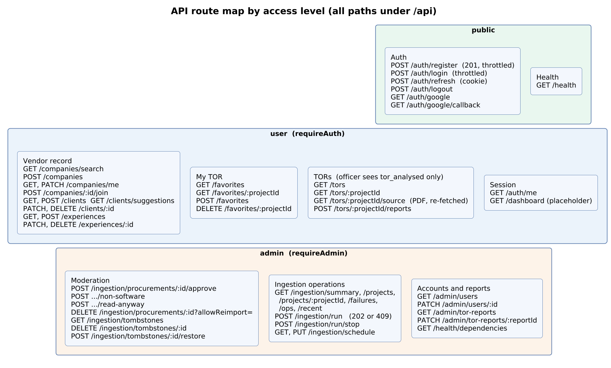

## 1. Conventions

| Topic | Rule |
| ----- | ---- |
| **Base path** | Everything is under `/api`. Local: `http://localhost:8080` |
| **Format** | JSON in and out. Field names on the wire are **snake_case**; domain objects inside the API are camelCase. (The `Procurement` list/detail schema from `@torfun/types` is the exception: it is camelCase.) |
| **Authentication** | Two `httpOnly` cookies: `torfun_token` (access JWT, 15 min) and `torfun_refresh` (30 days, rotating). Cookies are `secure` in production. Browser calls need `credentials: 'include'` |
| **Access levels** | `public` · `user` (any signed-in account) · `admin` (`role = admin`) |
| **Validation** | Every route has a zod schema for params, query, body and response; an invalid request returns `400` with `{ message, errors }` |
| **Errors** | `{ message }` with the status below. A `5xx` always returns `"Internal server error"` and the detail goes to the log |
| **Pagination** | `limit` (default 50, max 200) and `offset`; responses carry `{ items, total, limit, offset }`. TOR reports: default 25, max 100 |
| **CORS** | Allowlist from `CORS_ORIGINS`, credentials allowed |
| **Rate limits** | 100 requests/min/IP globally. `/auth/login` and `/auth/register`: 30 per 15 min per IP **and** 10 per 15 min per account |

| Status | Raised as | Typical cause |
| ------ | --------- | ------------- |
| 400 | `BadRequestError` / validation | Bad input |
| 401 | `UnauthorizedError` | No, expired or revoked session |
| 403 | `ForbiddenError` | Signed in but not allowed (e.g. non-admin on an admin route) |
| 404 | `NotFoundError` | Missing, or **not visible to this role** (an officer asking for a held record gets 404, not 403) |
| 409 | `ConflictError` | A Run is already live; client still has recorded work; last admin |
| 429 | `TooManyRequestsError` | Rate limit |
| 500 | — | Bug; logged, never leaked |

## 2. How a request travels

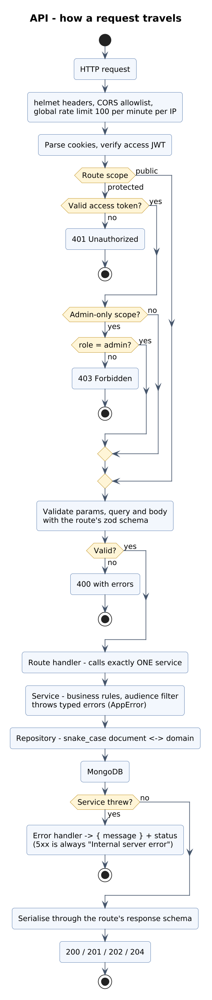

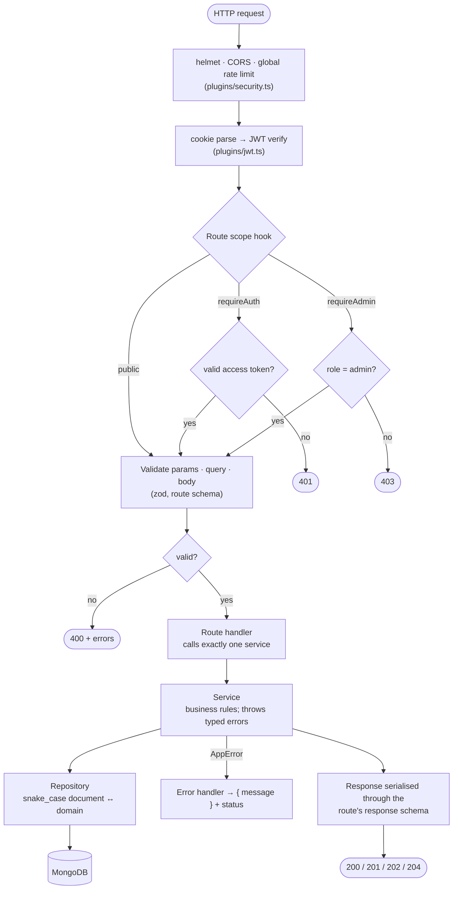

Two details worth knowing:

- **Visibility is enforced in the service, not the route.** `/tors/*` and `/ingestion/projects*` call the same data with an `audience` (`officer` or `admin`). An officer only ever sees `tor_analysed` records that were not removed from publication, and admin-only fields (`holdReason`, `approved`) are blanked.
- **Long work is started, not awaited.** `POST /ingestion/run` returns `202` immediately; progress is observed by polling `/ingestion/ops` (see §5).

## 3. Route map by access level

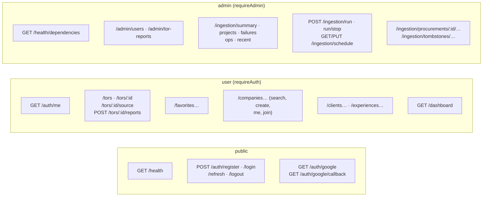

## 4. Endpoint reference

Access: **P** public · **U** any signed-in user · **A** admin.
`Officer visibility` means the response is filtered by role (see §2).

### 4.1 Health

| Method | Path | Acc. | Does | Responses |
| ------ | ---- | ---- | ---- | --------- |
| GET | `/health` | P | Liveness; touches nothing external | `200 { status: "ok", uptimeSeconds }` |
| GET | `/health/dependencies` | A | Live probes of MongoDB, Vertex AI and the open-data API | `200` |

### 4.2 Authentication and accounts

| Method | Path | Acc. | Does | Responses |
| ------ | ---- | ---- | ---- | --------- |
| POST | `/auth/register` | P | Creates a **Business Development Officer** and signs them in. Throttled | `201`; `409` username taken; `429` |
| POST | `/auth/login` | P | Username + password; sets both cookies. Throttled | `200`; `400`; `401` bad credentials; `403` account deactivated; `429` |
| POST | `/auth/refresh` | cookie | Exchanges the refresh cookie for a new pair; reuse of a revoked token revokes the whole family | `200`; `401` |
| POST | `/auth/logout` | P | Revokes the refresh family and clears both cookies | `200` |
| GET | `/auth/me` | U | The current account, with `company_name` | `200`; `401` |
| GET | `/auth/google` | P | Starts the Google redirect | `302` |
| GET | `/auth/google/callback` | P | Finishes sign-in, sets cookies, redirects to `WEB_APP_URL` | `302` |
| GET | `/admin/users` | A | All accounts | `200 { users }` |
| PATCH | `/admin/users/:id` | A | Body `{ role?, is_active? }` (at least one). Grants or revokes `admin`, activates or deactivates | `200`; `403` own account; `404`; `409` last active admin |

### 4.3 TORs (search and review)

| Method | Path | Acc. | Does | Responses |
| ------ | ---- | ---- | ---- | --------- |
| GET | `/tors` | U | Search and filter procurements. Officer visibility | `200 { items, total, limit, offset }` |
| GET | `/tors/:projectId` | U | One procurement. Officer visibility | `200`; `404` |
| GET | `/tors/:projectId/source` | U | The original main-TOR PDF as an attachment. **Re-downloaded from e-GP** by `zipId` (archives are not stored) | `200 application/pdf`; `404` |
| POST | `/tors/:projectId/reports` | U | Report a TOR `{ reason, details? }`; `details` required when `reason = other` | `201` |

**`GET /tors` query parameters** (`ProcurementListQuerySchema`):

| Group | Parameters |
| ----- | ---------- |
| Text | `q` (≤ 200 chars) · `deptName` · `industry` (keyword on project and agency names) |
| Lifecycle | `status` (Procurement Status) · `state` · `outcome` · `budgetYear` |
| Money | `minBudget` · `maxBudget` |
| Dates (`YYYY-MM-DD`) | `publishedFrom` · `publishedTo` · `deadlineFrom` · `deadlineTo` |
| Time left | `minDaysLeft` (0–365, Thai calendar days) — **not** combinable with a deadline range |
| Analysis | `techStack` · `targetPlatforms` (comma-separated, ≤ 20 values) |
| Paging | `limit` (≤ 200, default 50) · `offset` |

Ranges are validated: a maximum below its minimum returns `400`.

### 4.4 My TOR (favourites) and reports

| Method | Path | Acc. | Does | Responses |
| ------ | ---- | ---- | ---- | --------- |
| GET | `/favorites` | U | The caller's favourites that they can still see | `200 { favorites }` |
| GET | `/favorites/:projectId` | U | Is it favourited? | `200 { favorited }` |
| POST | `/favorites` | U | Favourite a project `{ project_id }` | `201`; `404` if not visible |
| DELETE | `/favorites/:projectId` | U | Remove | `204`; `404` |
| GET | `/admin/tor-reports` | A | Report queue; `status` = `pending` (default) · `dismissed` · `removed` · `all`; `limit`, `offset` | `200 { items, total, limit, offset }` |
| PATCH | `/admin/tor-reports/:reportId` | A | `{ action: "dismiss" \| "remove_tor", note? }`. `remove_tor` unpublishes the TOR | `200` |

### 4.5 Vendor record (Company, Clients, Experience)

| Method | Path | Acc. | Does | Responses |
| ------ | ---- | ---- | ---- | --------- |
| GET | `/companies/search?q=` | U | Typeahead over Thai company names | `200 { companies }` |
| POST | `/companies` | U | Create a Company and join it | `201` |
| GET | `/companies/me` | U | The caller's Company | `200`; `404` if none |
| PATCH | `/companies/me` | U | Correct it | `200`; `404` |
| POST | `/companies/:id/join` | U | Point the caller at an existing Company | `200`; `404` |
| GET | `/clients` | U | The caller's Clients | `200 { clients }` |
| GET | `/clients/suggestions?kind=&q=` | U | Government names drawn from agencies already seen | `200 { suggestions }` |
| POST | `/clients` | U | Record a Client | `201`; `409` before a Company exists |
| PATCH | `/clients/:id` | U | Correct | `200`; `404` |
| DELETE | `/clients/:id` | U | Remove | `204`; `409` if work is recorded against it |
| GET | `/experiences` | U | The caller's recorded work | `200 { experiences }` |
| POST | `/experiences` | U | Record work (client and project name required) | `201` |
| PATCH | `/experiences/:id` | U | Correct | `200` |
| DELETE | `/experiences/:id` | U | Remove | `204` |

Clients and Experience are scoped to the caller's Company: another Company's
records behave as if they do not exist.

### 4.6 Ingestion operations (admin only)

| Method | Path | Does | Responses |
| ------ | ---- | ---- | --------- |
| GET | `/ingestion/summary` | Counts by State and Outcome, plus agency names | `200` |
| GET | `/ingestion/projects` | List and filter **every** procurement (same query as `/tors`, plus `state` / `outcome`) | `200` |
| GET | `/ingestion/projects/:projectId` | One procurement, full record | `200`; `404` |
| GET | `/ingestion/failures` | The failure log (stage, kind `fault`/`no_tor`) | `200 { items }` |
| GET | `/ingestion/ops` | Operations view: run state, live work, history, trends | `200` |
| GET | `/ingestion/recent?limit=` | Most recently updated records (default 5, clamped to 20) | `200 { items }` |
| POST | `/ingestion/run` | Start a Run (empty body) | `202 { started, message }`; `409` a Run is live |
| POST | `/ingestion/run/stop` | Graceful stop; the requester is taken from the session | `202 { stopping }`; `409` none running |
| GET | `/ingestion/schedule` | Schedule plus `lastRunAt`, `nextRunAt`, `upcomingRunAts` | `200` |
| PUT | `/ingestion/schedule` | `{ enabled, mode, timeOfDay, weekdays, everyHours }`; `everyHours` 6–168 | `200`; `400` |

### 4.7 Moderation (admin only)

| Method | Path | Does | Responses |
| ------ | ---- | ---- | --------- |
| POST | `/ingestion/procurements/:projectId/approve` | Approve a held record; officers can now see it | `204`; `404`; `409` |
| POST | `/ingestion/procurements/:projectId/non-software` | Mark non-software → tombstone | `204`; `404` |
| POST | `/ingestion/procurements/:projectId/read-anyway` | Read an `out_of_scope` project after all (starts a one-project Run) | `202`; `404`; `409` |
| DELETE | `/ingestion/procurements/:projectId?allowReimport=true\|false` | Delete. `allowReimport` is **required** — whether the runner may pull it again is the admin's decision, never a default | `204`; `404` |
| GET | `/ingestion/tombstones` | List tombstones | `200 { items }` |
| DELETE | `/ingestion/tombstones/:projectId` | Remove a tombstone | `204`; `404` |
| POST | `/ingestion/tombstones/:projectId/restore` | Lift the tombstone and re-retrieve (one-project Run) | `202`; `404`; `409` |

### 4.8 Placeholders

`GET /dashboard` (user) and `GET /admin/test` (admin) only return a greeting.
They are not part of the product surface (SRS OI-07).

## 5. Key interaction sequences

### 5.1 Officer reads and verifies a TOR

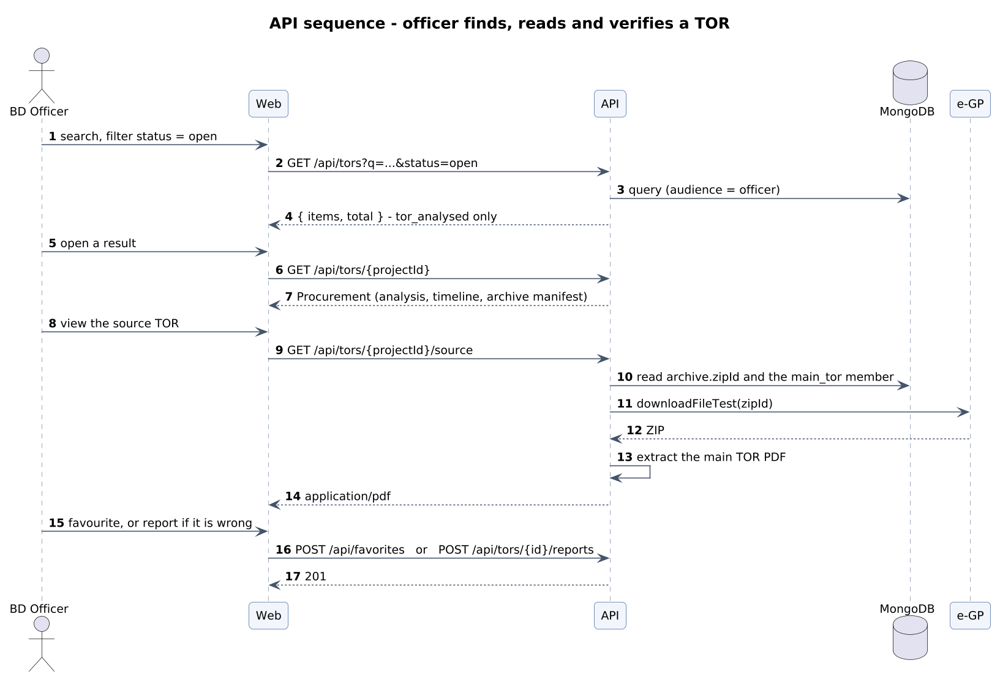

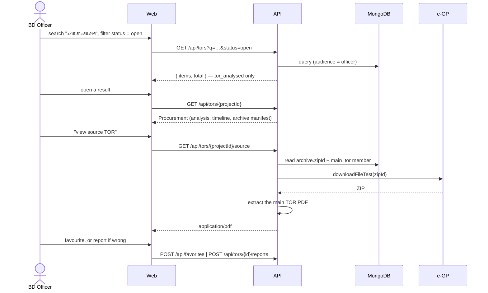

### 5.2 Administrator starts a Run and watches it

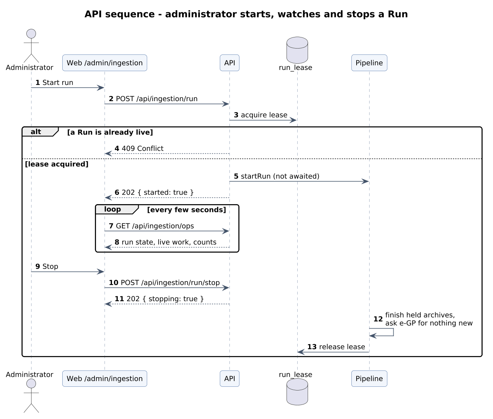

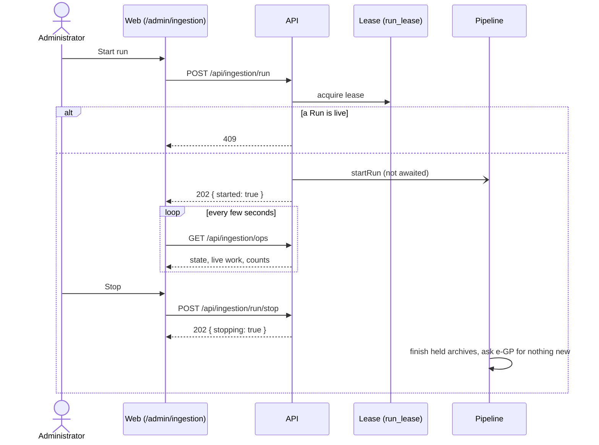

### 5.3 Administrator resolves a held record

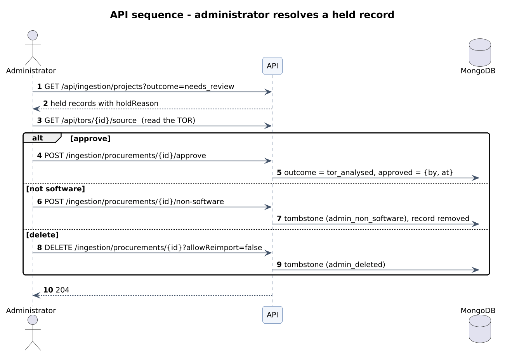

Authentication sequence: [diagrams/png/15-seq-auth.png](diagrams/png/15-seq-auth.png).

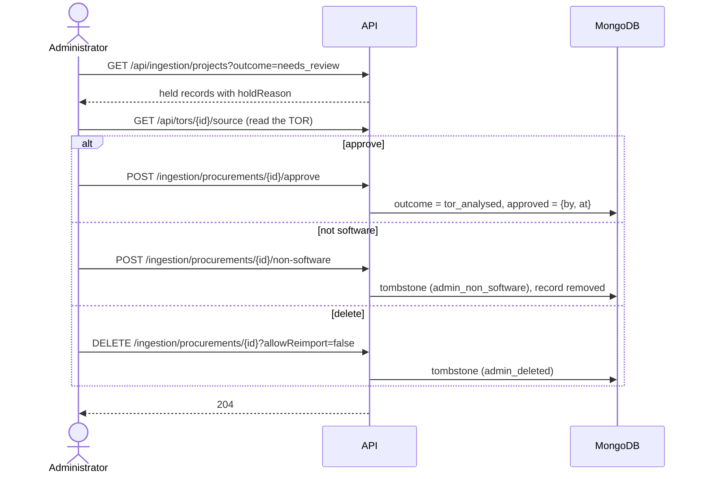

## 6. Resource model (as the API exposes it)

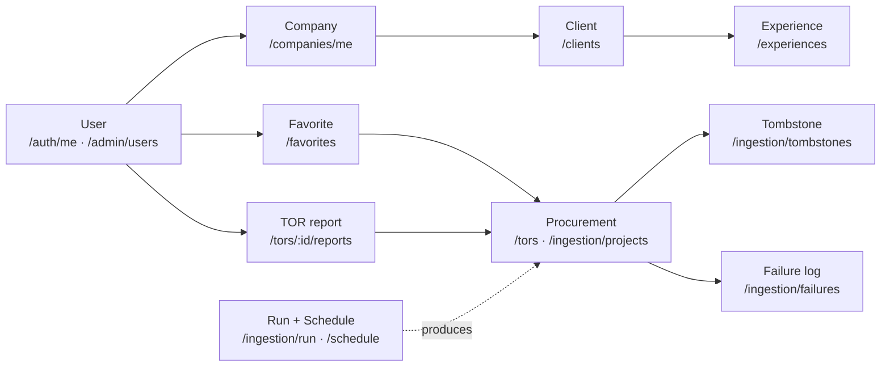

## 7. Change rules

- Request and response shapes live in `packages/types`; changing a schema breaks both apps' compile, which is intended.
- A wire field rename is a breaking change for `apps/web` (snake_case is a contract, not a style).
- A new route group gets its own plugin scope so `requireAuth` / `requireAdmin` is applied once per group, not per route.
- Keep this page and [`apps/api/README.md`](../apps/api/README.md#endpoints) in step; the README's table is the shorter summary.
