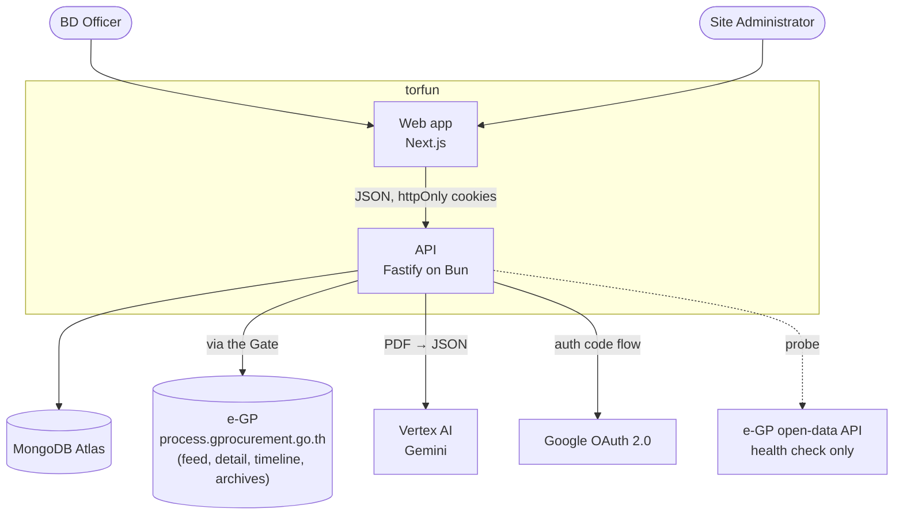
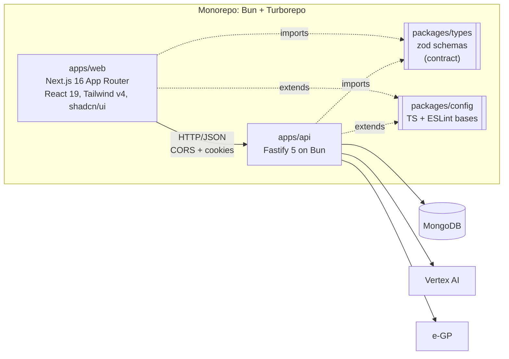
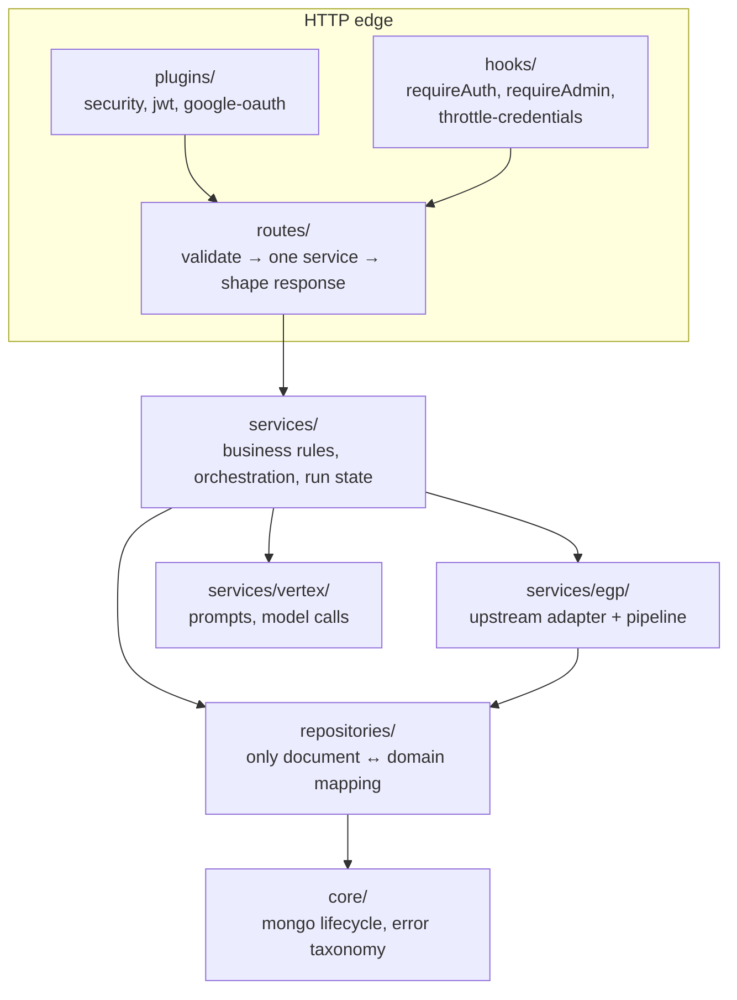
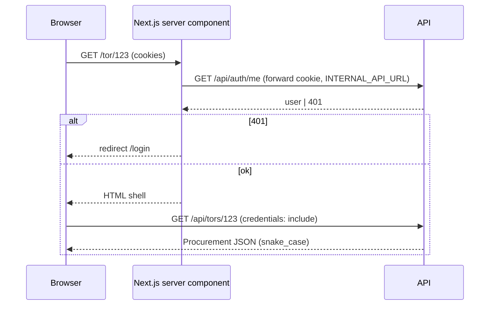
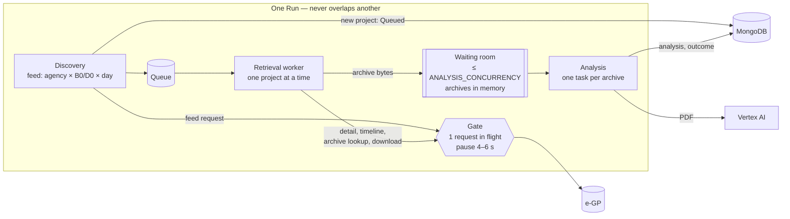
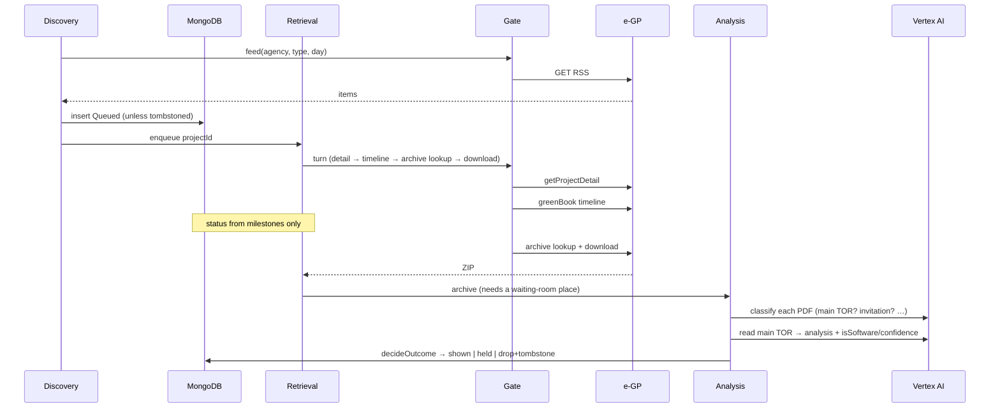
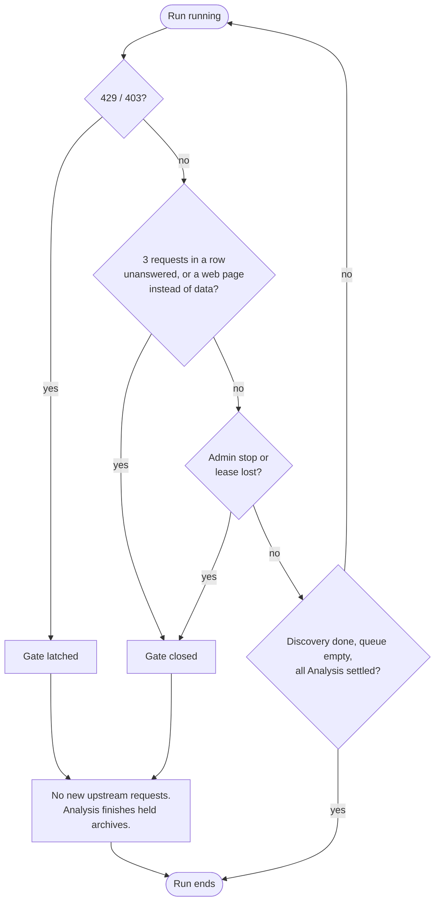
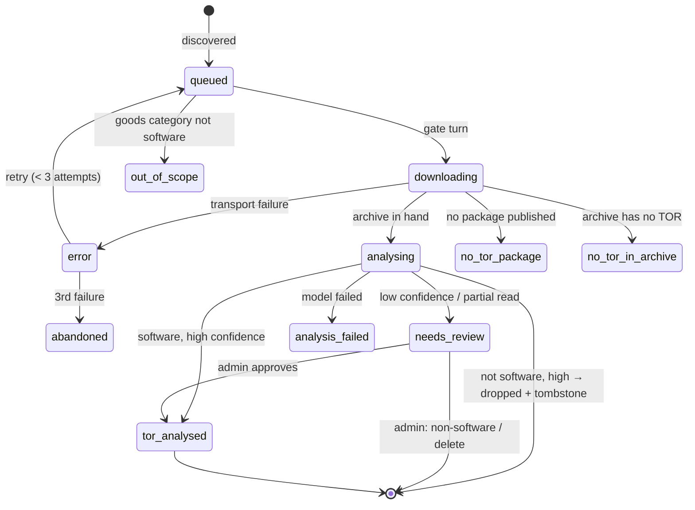
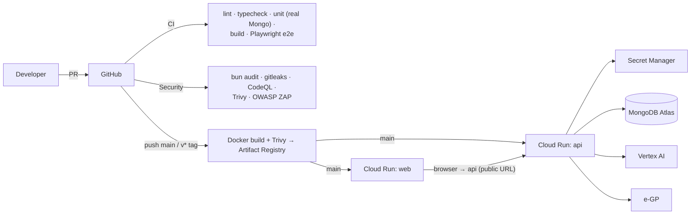

# Architecture — torfun

|             |                                                                |
| ----------- | -------------------------------------------------------------- |
| **Version** | 0.1 (draft)                                                    |
| **Baseline**| `develop` @ `5e622a3`                                          |
| **Format**  | arc42 sections, C4-style views; diagrams are Mermaid           |
| **Related** | [system-requirements.md](system-requirements.md) · [data-model.md](data-model.md) · [`CONTEXT.md`](../CONTEXT.md) |

Requirement IDs (FR-*, NFR-*, CON-*) refer to [system-requirements.md](system-requirements.md).

## 1. Introduction and goals

torfun finds Thai government software procurement a software house can bid on.
The architecture exists to serve three goals, in priority order:

1. **Stay a good citizen upstream.** e-GP disallows crawling in `robots.txt`; the system operates under a research authorisation. Everything that touches e-GP goes through one gate (CON-01, NFR-UP-*).
2. **Be trustworthy.** Officers spend days on a bid based on what the system shows. Only data from real runs is shown; AI output is a summary with the source one click away (FR-ING-22, NFR-REL-06).
3. **Be cheap to change.** Layered API with enforced boundaries, a shared contract package, and in-memory seams for tests (NFR-MNT-*).

## 2. Constraints

| Constraint | Consequence |
| ---------- | ----------- |
| One request at a time to e-GP, pause after each, stop on refusal | Pipeline is gate-centred; throughput is intentionally low |
| `process5` search is behind Cloudflare Turnstile and must not be used | Discovery uses the RSS announcement feed by agency × type × day |
| No service-account keys (org policy) | ADC with impersonation locally; Cloud Run runtime identity in production |
| TOR documents are not stored | Archives live in memory during a Run; source is re-fetched by `zipId` on demand |
| Software + e-bidding only | Encoded in schemas and in what Discovery admits |
| Bun + Turborepo monorepo | One lockfile, shared `packages/types` and `packages/config` |

## 3. System context



## 4. Solution strategy

| Problem | Decision |
| ------- | -------- |
| Politeness toward e-GP | A single `site-gate` shared by Discovery and Retrieval; tiered turns; a refusal latches it |
| Slow upstream vs. expensive model | Three stages run side by side; only Analysis overlaps the gate; a bounded "waiting room" of in-memory archives applies back-pressure |
| AI may be wrong | Only high-confidence, whole-document answers act; the rest is held for an administrator (`decision.ts`) |
| Record "no TOR published" is not an error | Two-level status: coarse `state`, fine `outcome` |
| Web/API drift | `packages/types` zod schemas compile into both apps |
| Testing the API without infrastructure | `buildApp(env, repositories)` takes configuration and stores as parameters |
| Multi-instance safety | A database-backed lease allows one Run at a time |

## 5. Building blocks

### 5.1 Containers (C4 level 2)



| Container | Responsibility |
| --------- | -------------- |
| `apps/web` | UI, server-side session gating (`requireUser`/`requireAdmin`), a thin `lib/api.ts` client |
| `apps/api` | Auth, vendor record, search, moderation, ingestion pipeline, scheduler, AI calls |
| `packages/types` | Domain vocabulary and wire schemas, Thai display labels, session-cookie names, shared policy constants (`MAX_RETRIEVAL_ATTEMPTS`, `RECORD_DEADLINE_MS`) |
| `packages/config` | Shared `tsconfig` and ESLint bases |

### 5.2 API layers (C4 level 3)

Dependencies point one way and ESLint enforces it (NFR-MNT-01).



| Layer | Owns | Must not |
| ----- | ---- | -------- |
| `routes/` | HTTP: validate input, call one service, shape output | import repositories or `core/mongo` |
| `services/` | Business rules, orchestration | import Fastify request/reply/instance types |
| `repositories/` | Data access, document↔domain mapping, snake_case↔camelCase | contain business rules |
| `core/` | Connection lifecycle, error taxonomy | know any feature |

**Composition root.** `app.ts` is the only file that constructs anything. Plugins
register in order (cookies → JWT → anything that signs), then repositories, then
services, which are decorated onto the Fastify instance (`app.authService`, …).
`buildApp(env, repositories?)` accepts configuration and stores as parameters;
tests pass in-memory stores and drive the whole stack with `app.inject`.

**Services** (from `app.ts`): `AuthService`, `AdminUsersService`, `CompanyService`,
`ClientService`, `ExperienceService`, `TorService`, `FavoriteService`,
`TorReportService`, `IngestionService`, `ProcurementAdminService`,
`ScheduleService`, `SchedulerService`, `DiagnosticsService`.

**Errors.** Services throw typed errors from `core/errors.ts`; one error handler
maps them to `{ message }` (plus `errors` for validation). Routes never craft
status codes for failures.

**Persistence.** MongoDB connects lazily so `buildApp()` works with no database.

### 5.3 Web structure

```
apps/web/src
├─ app/                 routes (App Router); (chrome) group adds header/footer
├─ components/
│  ├─ ui/               shadcn primitives (generated)
│  ├─ layout/           header, footer, single nav-config
│  ├─ landing/          sections + GSAP scroll layer (only place GSAP is used)
│  ├─ search/ tor-review/ favorited/ company/ onboarding/ auth/
│  ├─ procurements/ ingestion/ admin/ admin-dashboard/   admin consoles
└─ lib/                 api client, session, config, csp, formatters
```

Data flow:



- Server components gate access (`requireUser`, `requireAdmin`); the session cookie is `httpOnly` so only the server can read it.
- Client components use `lib/api.ts`, which throws `ApiError` with status `0` for network failure vs. the HTTP status otherwise.
- Interactive consoles follow one pattern: a `use*Data` hook owns fetch/polling, the component owns UI state, presentation splits into siblings.
- `NEXT_PUBLIC_API_URL` is inlined at build time; server-side rendering inside Docker uses `INTERNAL_API_URL` (`http://api:8080`).

## 6. Runtime view

### 6.1 A Run: three stages, one gate



Gate priority when it frees: **new days → never-read projects → refreshes → history** (FR-RUN-06).

### 6.2 Sequence of one project



If the timeline is unchanged for an already-read project, no archive or model
call is made; if the invitation date moved, only the invitation is re-read
(FR-ING-06).

### 6.3 How a Run stops



Projects not taken are left as they were, with no attempt spent.

### 6.4 State and Outcome lifecycle

State is derived from Outcome through `OUTCOME_STATE` (NFR-REL-02).



| State | Outcomes |
| ----- | -------- |
| Queued | `queued`, `error` |
| Processing | `downloading`, `analysing` |
| Completed | `tor_analysed`, `needs_review`, `analysis_failed`, `no_tor_in_archive`, `out_of_scope` |
| Failed | `no_tor_package`, `abandoned` |

Officers see only `tor_analysed` that has not been removed from publication.

### 6.5 Authentication

```mermaid
sequenceDiagram
    participant B as Browser
    participant A as API
    participant G as Google
    B->>A: POST /auth/login {username, password}
    A-->>B: Set-Cookie torfun_token (15 min), torfun_refresh (30 d)
    B->>A: any request (cookie)
    A-->>B: 401 when the access token has expired
    B->>A: POST /auth/refresh (refresh cookie)
    A->>A: rotate; reuse of a revoked token revokes the family
    A-->>B: new cookie pair
    Note over B,G: Google path: /auth/google → G → /auth/google/callback → redirect to web
```

### 6.6 Moderation and restore

Administrator overrides live in `ProcurementAdminService` (outside the audience
rule). **Restore** is a one-project Run started with
`startRun({ onlyProject, beforeRun })`: once the lease is held, the tombstone is
lifted and the record rebuilt from the feed snapshot the tombstone kept, then
retrieved normally. A tombstone written before snapshots existed cannot be
rebuilt; the project returns only if a later Run's days include it.

### 6.7 Scheduling

`SchedulerService` (started by `server.ts`, not `buildApp`, so tests never start a timer) polls the stored `Schedule` and calls `startRun`. The lease prevents overlap. Modes: every N hours (6–168) or weekdays at a time of day, Asia/Bangkok; default off.

## 7. Deployment view



- **Local:** `docker compose up -d mongodb` + `bun run dev` (API :8080, web :3000), or `bun run docker:up` for all three containers. Vertex access via `gcloud auth application-default login --impersonate-service-account=…`; Compose mounts `~/.config/gcloud` read-only.
- **Production:** Cloud Run services with distinct runtime service accounts (API: `aiplatform.user`, `secretmanager.secretAccessor`). Secrets from Secret Manager: `MONGODB_URI`, `JWT_SECRET`, `GOOGLE_CLIENT_ID`, `GOOGLE_CLIENT_SECRET`, `EGP_API_KEY`. Deploy auth via Workload Identity Federation.
- **Configuration** is validated at start-up by zod; a missing variable stops the container rather than degrading a feature. A new variable must be added to `env.ts`, `.env.example`, `turbo.json` (and Compose if needed).

## 8. Cross-cutting concepts

| Concept | Approach |
| ------- | -------- |
| **Authorisation** | `requireAuth` / `requireAdmin` applied once per route scope; `audienceOf(role)` → `officer` \| `admin`; any non-admin role defaults to the narrower view |
| **Visibility** | `isVisibleTo` / `presentTo` in `services/audience.ts`: officers see `tor_analysed` and not removed; admin-only fields blanked |
| **Wire vs. domain naming** | snake_case on the wire, JWT claims and Mongo documents; camelCase in domain objects; conversion only in repositories/schemas |
| **Validation** | zod schemas on every route, imported from `@torfun/types`; `fastify-type-provider-zod` |
| **Errors** | typed errors + a single handler; expected rejections log at debug |
| **Security headers & limits** | helmet (CSP), CORS allowlist, 100 req/min/IP, 30/15 min/IP and 10/15 min/account on credentials |
| **Resilience** | per-record deadline 5 min; 2 retries with 5 s/15 s back-off; 3 attempts then `abandoned`; refusal latches the gate |
| **Idempotence** | the lease gives one Run; agency-days saved as read; Feed Cursor covers only fully-read days |
| **Observability** | pino logs (pretty in dev); ingestion failure log, run history, live view, dependency health |
| **AI governance** | prompts in versioned TS modules; each analysis stores `promptVersion`; document text is data not instructions; prompt rules force `low` confidence for mixed/ambiguous work |
| **Testing** | in-memory stores through `app.inject` for routes; real Mongo for repositories; vitest for web; Playwright e2e on a production build |
| **Internationalisation** | Thai labels colocated with enums in `packages/types` |
| **Time** | Asia/Bangkok; Thai calendar days for "days left" |

## 9. Architecture decisions

Decision records are cited in code (ADR-0002, -0004, -0006, -0007, -0009, -0015,
-0018, -0020, -0021) but the `docs/adr/` directory is not on this branch.
[system-requirements §9](system-requirements.md#9-key-decisions-that-constrain-requirements) lists them as cited.
Recommended: restore them, and use the Nygard format (context, decision,
consequences) for any new decision that is expensive to reverse.

## 10. Quality requirements

Quality goals and where they are realised:

| Goal | Scenario | Mechanism |
| ---- | -------- | --------- |
| Upstream-safe | e-GP replies 429 mid-Run | Gate latches; Run drains; nothing more requested |
| Trustworthy | A TOR mixes software and hardware | Prompt forces `low` → held → admin reads source |
| Recoverable | API restarts mid-Run | Lease expires; saved agency-days and records persist; Feed Cursor unchanged for unread days |
| Testable | Route test with no DB | `buildApp(testEnv(), { users: inMemory… })` |
| Changeable | Add a field to `Procurement` | Edit zod schema → both apps fail to compile until updated |

## 11. Risks and technical debt

| # | Item | Impact | Mitigation |
| - | ---- | ------ | ---------- |
| 1 | e-GP endpoints/RSS shape are undocumented and may change | Ingestion silently yields nothing | Failure log, health checks; add alerting |
| 2 | Research authorisation limits not recorded | Policy drift | Record/link (system-requirements OI-01) |
| 3 | Match scoring only a placeholder type | Headline feature missing | Plan with company key (system-requirements OI-03) |
| 4 | Records with failed analysis are not retried (archives not stored) | Manual re-run needed | Admin action; accepted trade-off |
| 5 | In-memory waiting room is lost if the process dies | Re-download on next Run | Bounded size; refresh logic |
| 6 | Auth-side code uses older snake_case style | Inconsistent codebase | Convert on touch |
| 7 | Placeholder endpoints `/dashboard`, `/admin/test` | Dead surface | Remove or implement |
| 8 | ADR and migrations directories missing from branch | Lost rationale | Restore |
| 9 | `apps/web/README.md` says officer `/search` is admin-only; code calls `/api/tors` | Misleading | Update |

## 12. Glossary

See [system-requirements §1.3](system-requirements.md#13-definitions-acronyms-and-abbreviations) and
[`CONTEXT.md`](../CONTEXT.md) — the latter is canonical; use its terms, and
avoid the aliases it lists.
