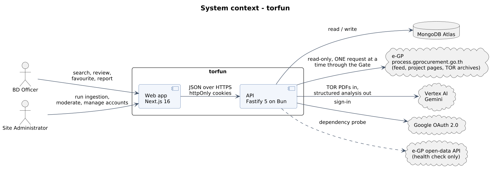
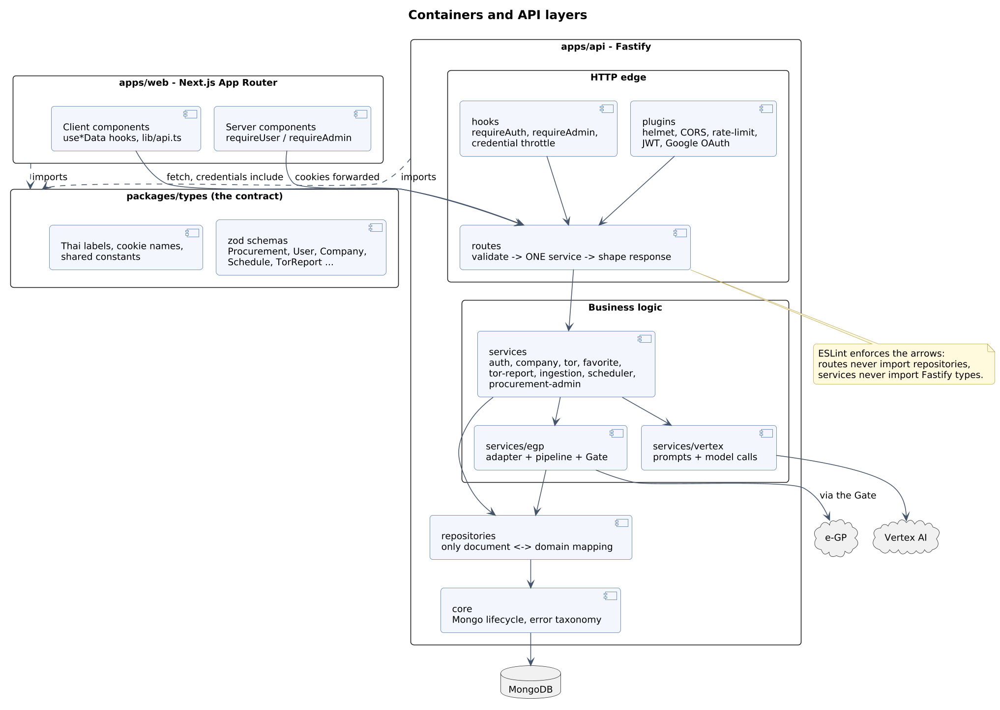
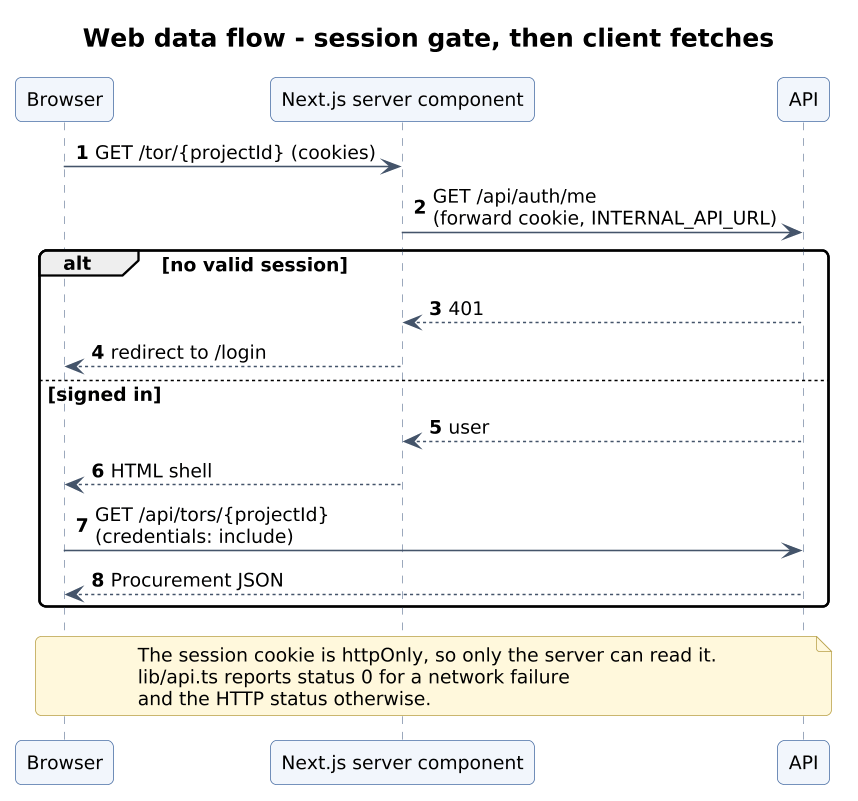
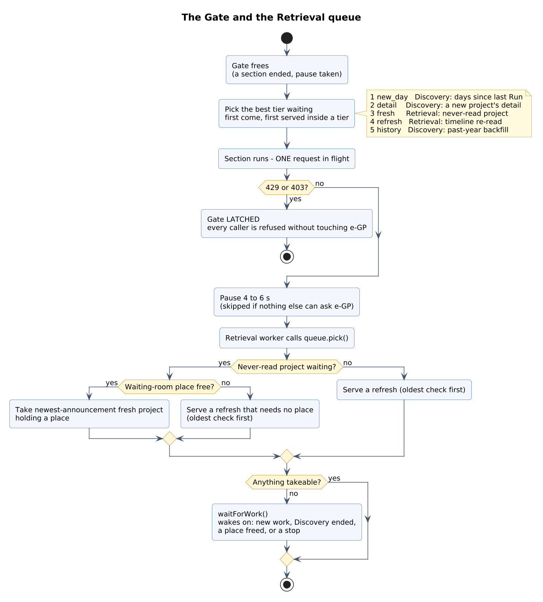
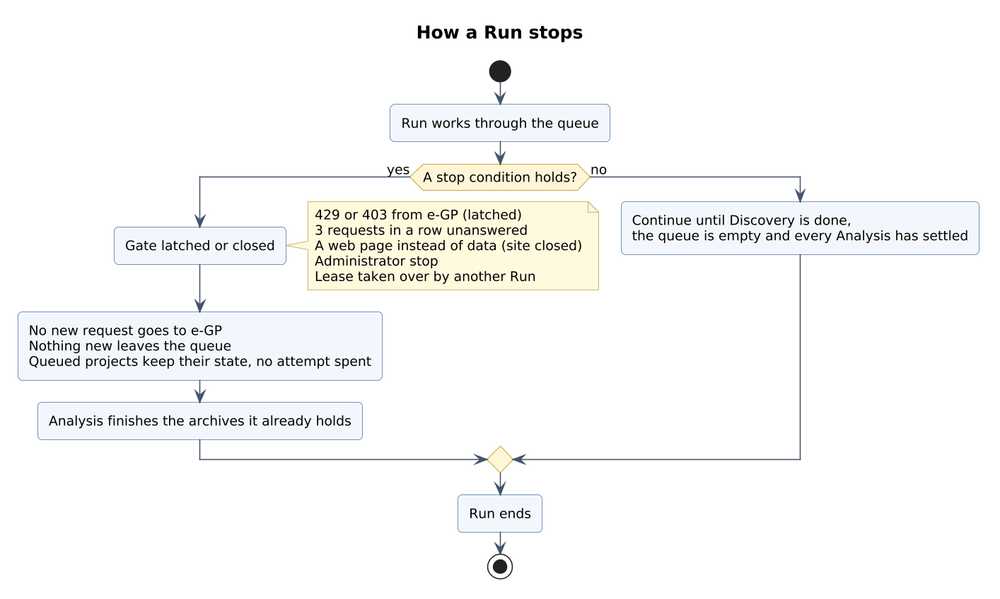
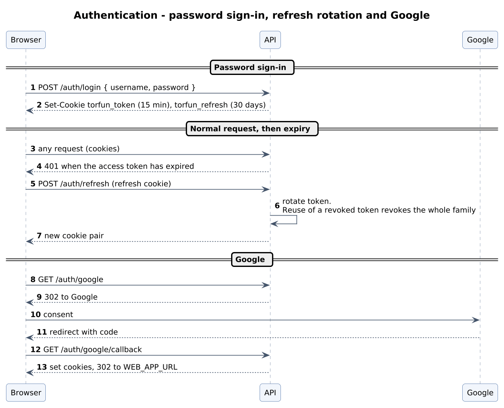
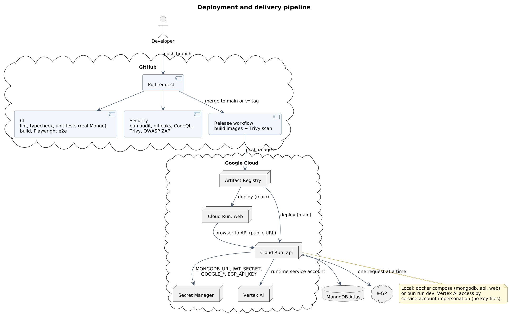

# Architecture

Baseline: `develop` @ `5e622a3`. Requirement IDs (FR-*, NFR-*, CON-*) come from
[system-requirements.md](system-requirements.md). Diagram sources are in
[`diagrams/`](diagrams/README.md).

Related: [ingestion-flow.md](ingestion-flow.md) for the retrieval pipeline,
[api.md](api.md) for the HTTP surface, [data-model.md](data-model.md) for storage.

## 1. Goals

torfun finds Thai government software procurement that a software house can bid
on. Three goals shape the design, in priority order:

1. Stay a good citizen upstream. e-GP's `robots.txt` disallows crawling and the project reads it under a research authorisation, so every request goes through one gate (CON-01, NFR-UP-*).
2. Be trustworthy. Officers spend days on a bid based on what the system shows, so only data from real runs is shown and the source PDF is always one click away (FR-ING-22, NFR-REL-06).
3. Be cheap to change. The API has enforced layers, both apps share one contract package, and storage is injectable in tests (NFR-MNT-*).

## 2. Constraints

| Constraint | Consequence |
| ---------- | ----------- |
| One request at a time to e-GP, a pause after each, stop on refusal | The pipeline is built around a single gate; throughput is low on purpose |
| The `process5` search sits behind Cloudflare Turnstile and is never called | Discovery reads the RSS announcement feed by agency, type and day |
| The organisation blocks service-account keys | Local development impersonates a service account; Cloud Run uses its runtime identity |
| TOR documents are not stored | Archives live in memory during a Run; the source PDF is re-downloaded by `zipId` on request |
| Software and e-bidding only | Encoded in the schemas and in what Discovery admits |

## 3. System context



Officers and administrators use the web app. The API reads e-GP through the
gate, sends TOR PDFs to Vertex AI (Gemini), signs users in through Google, and
stores everything in MongoDB Atlas. The e-GP open-data API is probed by the
health check and kept for a future winner lookup.

## 4. Building blocks



| Block | Responsibility |
| ----- | -------------- |
| `apps/web` | UI, server-side session gating, a thin `lib/api.ts` client |
| `apps/api` | Auth, vendor record, search, moderation, ingestion pipeline, scheduler, AI calls |
| `packages/types` | Zod schemas, Thai display labels, session cookie names, shared policy constants |
| `packages/config` | Shared `tsconfig` and ESLint bases |

### API layers

Dependencies point one way and ESLint enforces it (NFR-MNT-01).

| Layer | Owns | Must not |
| ----- | ---- | -------- |
| `routes/` | Validate input, call one service, shape the response | import repositories or `core/mongo` |
| `services/` | Business rules and orchestration | import Fastify request, reply or instance types |
| `repositories/` | Data access and the only document-to-domain mapping | contain business rules |
| `core/` | Connection lifecycle and the error taxonomy | know about any feature |

`app.ts` is the only file that constructs anything. Plugins register in order
(cookies, then JWT, then anything that signs), then repositories, then services,
which are decorated onto the Fastify instance. `buildApp(env, repositories?)`
takes configuration and stores as parameters, so tests pass in-memory stores and
exercise routing, validation, hooks and error mapping through `app.inject`.

Services throw typed errors (`NotFoundError`, `ConflictError`, ...) and one
error handler maps them to `{ message }`. MongoDB connects lazily, so
`buildApp()` works with no database.

The services are `AuthService`, `AdminUsersService`, `CompanyService`,
`ClientService`, `ExperienceService`, `TorService`, `FavoriteService`,
`TorReportService`, `IngestionService`, `ProcurementAdminService`,
`ScheduleService`, `SchedulerService` and `DiagnosticsService`.

### Web structure

```
apps/web/src
  app/          routes; the (chrome) group adds the header and footer
  components/   ui (shadcn), layout, landing, search, tor-review, favorited,
                company, onboarding, auth, procurements, ingestion, admin
  lib/          api client, session, config, CSP, formatters
```



Server components gate access with `requireUser` and `requireAdmin`; the session
cookie is `httpOnly`, so only the server can read it. Client components call the
API through `lib/api.ts`. Each console has a `use*Data` hook for fetching and
polling, a component for UI state, and sibling components for presentation.
`NEXT_PUBLIC_*` values are inlined at build time, so server rendering inside
Docker reaches the API through `INTERNAL_API_URL`.

## 5. Runtime

The ingestion pipeline is the core of the system and has its own page:
[ingestion-flow.md](ingestion-flow.md). In short, a Run has three stages that
overlap. Discovery and Retrieval share the gate and talk to e-GP; Analysis talks
only to Vertex AI.



A Run ends when the work is done or the gate closes.



Authentication uses two `httpOnly` cookies: a 15-minute access JWT and a 30-day
refresh token that rotates on every use. Presenting a revoked token revokes the
whole token family.



`SchedulerService` starts Runs on the stored schedule. `server.ts` starts it,
not `buildApp`, so tests never run a timer. The lease keeps Runs from
overlapping.

## 6. Deployment



Locally, `docker compose up -d mongodb` plus `bun run dev` runs the stack, or
`bun run docker:up` runs all three containers. Vertex AI access goes through
service-account impersonation (`gcloud auth application-default login
--impersonate-service-account=...`); Compose mounts `~/.config/gcloud`
read-only.

In production, both services run on Cloud Run with separate runtime service
accounts. The API's account has `aiplatform.user` and `secretmanager.secretAccessor`.
Secrets come from Secret Manager (`MONGODB_URI`, `JWT_SECRET`, `GOOGLE_CLIENT_ID`,
`GOOGLE_CLIENT_SECRET`, `EGP_API_KEY`), and deploys authenticate through
Workload Identity Federation.

The API validates its whole configuration at start-up and refuses to start on a
missing variable. A new variable goes in `env.ts`, `.env.example` and
`turbo.json`, and in `docker-compose.yml` if the container needs it.

## 7. Cross-cutting concerns

| Concern | Approach |
| ------- | -------- |
| Authorisation | `requireAuth` and `requireAdmin` once per route scope. `audienceOf(role)` returns `officer` or `admin`, and any other role gets the narrower view |
| Visibility | `isVisibleTo` and `presentTo` in `services/audience.ts`. Officers see `tor_analysed` records that were not removed from publication, with admin-only fields blanked |
| Naming | snake_case on the wire, in JWT claims and in Mongo documents; camelCase in domain objects; conversion only in repositories |
| Validation | A zod schema on every route, imported from `@torfun/types` |
| Security | helmet with a CSP, a CORS allowlist, 100 requests per minute per IP, and 30 per 15 minutes per IP plus 10 per 15 minutes per account on credential routes |
| Resilience | A 5-minute record deadline, two retries with 5 s and 15 s back-off, three attempts before `abandoned`, and a latched gate on refusal |
| Idempotence | One Run at a time through a lease. Agency-days are saved as they are read, and the Feed Cursor covers only fully read days |
| Observability | pino logs, the ingestion failure log, run history, a live view and dependency health |
| AI governance | Prompts are versioned TypeScript modules, each analysis stores its `promptVersion`, document text is treated as data, and mixed or unclear work forces low confidence |
| Testing | In-memory stores through `app.inject` for routes, real MongoDB for repositories, Vitest for web, Playwright e2e on a production build |
| Time | Asia/Bangkok, with Thai calendar days for "days left" |

## 8. Quality scenarios

| Scenario | Mechanism |
| -------- | --------- |
| e-GP answers 429 mid-Run | The gate latches, the Run drains, and nothing more is requested |
| A TOR mixes software and hardware | The prompt forces low confidence, the record is held, and an administrator reads the source |
| The API restarts mid-Run | The lease expires, saved agency-days and records persist, and unread days stay unread in the Feed Cursor |
| A route test with no database | `buildApp(testEnv(), { users: inMemory })` |
| A new field on `Procurement` | Edit the zod schema; both apps fail to compile until they handle it |

## 9. Decisions

The code cites ADR-0002, -0004, -0006, -0007, -0009, -0015, -0018, -0020 and
-0021, but `docs/adr/` is not on this branch. [SRS section 6.2](SRS.md#62-decision-log)
records what each citation implies. New decisions that are expensive to reverse
should be written up as ADRs with context, decision and consequences.

## 10. Risks and debt

| Item | Impact | Mitigation |
| ---- | ------ | ---------- |
| e-GP endpoints and the RSS shape are undocumented | Ingestion can silently yield nothing | Failure log and health checks; add alerting |
| The research authorisation's limits are not recorded | Policy can drift | Record or link them (SRS D-09) |
| Match scoring is only a placeholder type | The headline feature is missing | Plan it with a company key (SRS D-05) |
| Failed analyses are not retried, because archives are not stored | Manual re-run needed | Accepted trade-off |
| The waiting room is in memory | A crash means re-downloading | Bounded size; refresh logic |
| The auth code uses older snake_case identifiers | Inconsistent style | Convert when touched |
| `/dashboard` and `/admin/test` are placeholders | Dead surface | Remove or implement |
| `docs/adr/` and `docs/migrations/` are missing | Lost rationale | Restore |
| `apps/web/README.md` says officer search is admin-only | Misleading | Update; the client calls `/api/tors` |

Glossary: [`CONTEXT.md`](../CONTEXT.md) is canonical.
