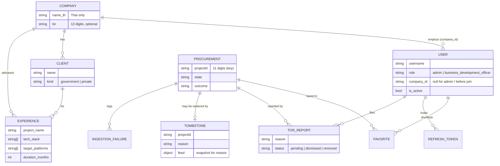

# Data model — torfun

|             |                                                                  |
| ----------- | ---------------------------------------------------------------- |
| **Version** | 0.1 (draft)                                                      |
| **Baseline**| `develop` @ `5e622a3`                                            |
| **Source of truth** | `packages/types/src/*.ts` (domain) and `apps/api/src/repositories/*.ts` (stored documents) |
| **Related** | [system-requirements.md](system-requirements.md) · [architecture.md](architecture.md) · [`CONTEXT.md`](../CONTEXT.md) |

This page is a map, not a copy: field-level truth lives in the zod schemas. If
this page and the code disagree, the code wins — fix this page.

## 1. Conventions

- Database: MongoDB (Atlas; `mongodb-atlas-local:8.0` for development and CI).
- Stored documents are **snake_case**; domain objects are **camelCase**. The mapping happens only in `repositories/` (CON-06, DR-02). Nothing above a repository sees an `ObjectId`.
- `Procurement` is keyed by the upstream 11-digit `projectId`, not an `ObjectId`.
- Times are ISO-8601 strings in the domain; Thai calendar logic uses Asia/Bangkok.
- Stored-data schema changes ship an idempotent `mongosh` migration in `docs/migrations/` (NFR-MNT-05).

## 2. Collections

| Collection | Holds | Key / reference fields |
| ---------- | ----- | ---------------------- |
| `procurements` | The central record: feed data, retrieval data, timeline, analysis, State/Outcome | `projectId` |
| `tombstones` | Projects judged non-software; stops re-ingestion; keeps a feed snapshot for restore | `projectId` |
| `ingestion_failures` | Failure log shown to administrators | `projectId`, `stage`, `kind` |
| `ingestion_runs` | Finished Runs: start/end, counts | run id |
| `ingestion_meta` | Feed Cursor — contiguous range of fully-read days per agency × type | agency, type |
| `run_lease` | Single document: who holds the right to run, live view, in-flight work | fixed id |
| `schedule` | Single document: automatic-run setting and last run start | fixed id |
| `users` | Accounts; `role`; `password_hash` (only via `findCredentials`); `google_id`; `company_id` | `company_id → companies` |
| `refresh_tokens` | Hashed refresh tokens, token family, expiry, revocation | `user_id → users`, `family_id`, `token_hash` |
| `companies` | Vendor; Thai name, optional TIN; index on `name_th` | — |
| `clients` | Organisations a Company has delivered for (`government` \| `private`) | `company_id → companies` |
| `experiences` | Work a Company delivered | `company_id`, `client_id → clients` |
| `favorites` | A user's shortlisted procurements | `user_id → users`, `project_id → procurements` |
| `tor_reports` | Reports on a TOR and the administrator's review | `project_id`, `reporter_id → users` |

## 3. Entity relationships

Run-level collections (`ingestion_runs`, `ingestion_meta`, `run_lease`,
`schedule`) are operational state and have no foreign keys.

## 4. The `Procurement` record

Grouped by who writes it, as in `ProcurementSchema`:

| Group | Fields (domain names) | Written by |
| ----- | --------------------- | ---------- |
| Feed | `projectId`, `projectName`, `deptName`, `deptCode`, `announceDate`, `purchaseMethodName`, `discoveredAt` | Discovery |
| Project detail | `deptSubName`, `budgetYear`, `typeId`, `goodsId`, `projectMoney`, `priceBuild`, `detailReadAt` (null until read; never guessed) | Retrieval |
| Timeline | `timeline.status` (Procurement Status), `lastReadAt`, `commentsCloseAt`, `deadlineAt`, `stages.{drafted,invited,priced,evaluated,awarded,contracted}` | Retrieval — from milestones only, never a model |
| Pipeline | `state`, `outcome`, `attempts`, `statusHistory` (last 50), `holdReason` | Pipeline, `decideOutcome` |
| Moderation | `approved {by, at}`, `publicationRemoval {at, by, reportId}` | Administrator actions |
| Archive | `archive.zipId`, `archive.documents[]` (member, filename, bytes, role, read mode), `torAmbiguous` | Retrieval / classification |
| Analysis | `summary`, `scopeOfWork[]`, `budgetThb`, `deadlineAt`, `durationDays`, `techStack[]`, `targetPlatforms[]`, `requiredQualifications[]`, `reason`, `promptVersion` | Gemini (summary only — not an authority) |
| Bookkeeping | `updatedAt` | Repository |

Derived helper: `currentDeadline()` returns the comment deadline while
`drafting`, else e-GP's bid deadline, else the model-read deadline (flagged
`readByModel`).

## 5. Enumerations

| Enum | Values |
| ---- | ------ |
| `IngestionState` | `Queued`, `Processing`, `Completed`, `Failed` |
| `IngestionOutcome` | `queued`, `downloading`, `analysing`, `tor_analysed`, `needs_review`, `analysis_failed`, `no_tor_in_archive`, `no_tor_package`, `out_of_scope`, `error`, `abandoned` |
| `ProcurementStatus` | `drafting`, `open`, `evaluating`, `awarded`, `contracted`, `cancelled`, `unknown` |
| `DocumentRole` | `main_tor`, `tor_variant`, `not_tor`, `unreadable`, `invitation`, `bidding_document` |
| `HoldReason` | `ai_low_confidence`, `ai_not_software_low`, `partial_read` |
| `TombstoneReason` | `ai_not_software`, `admin_non_software`, `admin_deleted` |
| `TargetPlatform` | `macos`, `windows`, `mobile`, `web_app`, `other` |
| `UserRole` | `admin`, `business_development_officer` |
| `ClientKind` | `government`, `private` |
| `TorReportReason` | `unreasonable_requirements`, `incorrect_information`, `outdated`, `invalid_document`, `other` |
| `TorReportStatus` | `pending`, `dismissed`, `removed` |
| `ScheduleMode` | `interval`, `weekly` |
| Failure `stage` | `discovery`, `timeline`, `info`, `download`, `extract`, `analysis` |
| Failure `kind` | `fault`, `no_tor` |

`OUTCOME_STATE` (in `packages/types`) maps each outcome to exactly one state;
writers look the state up rather than choosing it.

## 6. Constants that shape the data

| Constant | Value | Meaning |
| -------- | ----- | ------- |
| `MAX_RETRIEVAL_ATTEMPTS` | 3 | Transport failures before `abandoned` |
| `RECORD_DEADLINE_MS` | 5 min | Longest one record may take in a Run |
| `STATUS_HISTORY_LIMIT` | 50 | Entries kept in `statusHistory` |
| `SOFTWARE_REASON_MAX_CHARS` | 200 | Max length of the model's reason / tombstone evidence |
| `FEED_HISTORY_DAYS` | 365 | How far back Discovery backfills |
| `FEED_BACKFILL_REQUESTS_PER_RUN` | 60 | History requests per Run |
| `MIN_/MAX_INTERVAL_HOURS` | 6 / 168 | Schedule bounds |
| `ACCESS_TTL` / `REFRESH_TTL` | 15 min / 30 days | Session lifetimes |

## 7. Data lifecycle and retention

| Data | Retention | Note |
| ---- | --------- | ---- |
| TOR PDFs / archives | **Not stored** | Held in memory during analysis; re-downloaded by `zipId` on demand (CON-05) |
| Procurements | Kept; deleted only by an administrator action | Delete may leave a tombstone |
| Tombstones | Kept until an administrator removes or restores | Carry a feed snapshot |
| Status history | Last 50 changes per record | |
| Refresh tokens | Until expiry or revocation | Reuse revokes the family |
| Personal data | Username, name, optional email, password hash, Google id | PDPA review open (system-requirements OI-05) |
