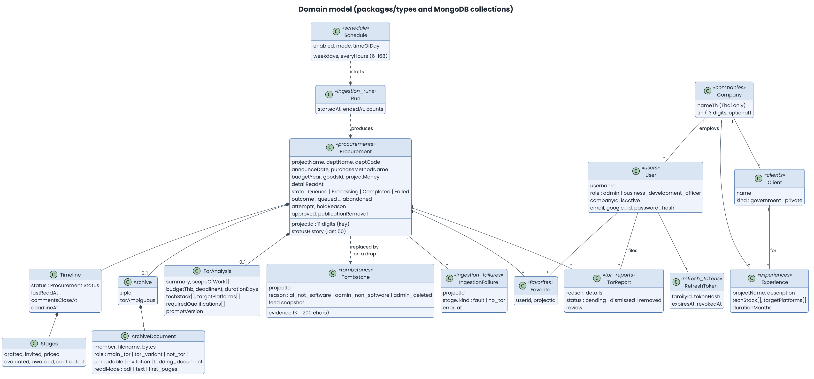

# Data model

Baseline: `develop` @ `5e622a3`. Field-level truth is in `packages/types/src/*.ts`
(domain) and `apps/api/src/repositories/*.ts` (stored documents). This page is a
map, so when it disagrees with the code, the code wins.

Related: [architecture.md](architecture.md), [ingestion-flow.md](ingestion-flow.md),
[`CONTEXT.md`](../CONTEXT.md).

## 1. Conventions

- MongoDB (Atlas; `mongodb-atlas-local:8.0` for development and CI).
- Stored documents use snake_case and domain objects use camelCase. The mapping lives only in `repositories/`, and nothing above a repository sees an `ObjectId`.
- A `Procurement` is keyed by the upstream 11-digit `projectId`.
- Times are ISO-8601 strings in the domain. Thai calendar logic uses Asia/Bangkok.
- A change to stored data ships an idempotent `mongosh` migration in `docs/migrations/`.

## 2. Domain model

## 3. Collections

| Collection | Holds | Key or reference |
| ---------- | ----- | ---------------- |
| `procurements` | The central record: feed data, retrieval data, timeline, analysis, State and Outcome | `projectId` |
| `tombstones` | Projects judged non-software, which stops re-ingestion, plus a feed snapshot for restore | `projectId` |
| `ingestion_failures` | The failure log shown to administrators | `projectId`, `stage`, `kind` |
| `ingestion_runs` | Finished Runs: start, end, counts | run id |
| `ingestion_meta` | The Feed Cursor: a contiguous range of fully read days per agency and type | agency, type |
| `run_lease` | One document: who may run, the live view, work in flight | fixed id |
| `schedule` | One document: the automatic-run setting and the last run start | fixed id |
| `users` | Accounts: `role`, `password_hash` (only through `findCredentials`), `google_id`, `company_id` | `company_id` to `companies` |
| `refresh_tokens` | Hashed refresh tokens with family, expiry and revocation | `user_id`, `family_id`, `token_hash` |
| `companies` | The vendor: Thai name, optional TIN, index on `name_th` | |
| `clients` | Organisations a Company delivered for (`government` or `private`) | `company_id` |
| `experiences` | Work a Company delivered | `company_id`, `client_id` |
| `favorites` | A user's shortlisted procurements | `user_id`, `project_id` |
| `tor_reports` | Reports on a TOR and the administrator's review | `project_id`, `reporter_id` |

The run-level collections (`ingestion_runs`, `ingestion_meta`, `run_lease`,
`schedule`) are operational state with no foreign keys.

## 4. The `Procurement` record

Grouped by who writes each part, as in `ProcurementSchema`:

| Group | Fields | Written by |
| ----- | ------ | ---------- |
| Feed | `projectId`, `projectName`, `deptName`, `deptCode`, `announceDate`, `purchaseMethodName`, `discoveredAt` | Discovery |
| Detail | `deptSubName`, `budgetYear`, `typeId`, `goodsId`, `projectMoney`, `priceBuild`, `detailReadAt` (null until read, never guessed) | Retrieval |
| Timeline | `timeline.status` (Procurement Status), `lastReadAt`, `commentsCloseAt`, `deadlineAt`, `stages.{drafted, invited, priced, evaluated, awarded, contracted}` | Retrieval, from milestones only, never a model |
| Pipeline | `state`, `outcome`, `attempts`, `statusHistory` (last 50), `holdReason` | The pipeline and `decideOutcome` |
| Moderation | `approved {by, at}`, `publicationRemoval {at, by, reportId}` | Administrator actions |
| Archive | `archive.zipId`, `archive.documents[]` (member, filename, bytes, role, read mode), `torAmbiguous` | Retrieval and classification |
| Analysis | `summary`, `scopeOfWork[]`, `budgetThb`, `deadlineAt`, `durationDays`, `techStack[]`, `targetPlatforms[]`, `requiredQualifications[]`, `reason`, `promptVersion` | Gemini. A summary, not an authority |
| Bookkeeping | `updatedAt` | The repository |

`currentDeadline()` returns the comment deadline while a project is `drafting`,
otherwise e-GP's bid deadline, otherwise the deadline the model read (flagged
`readByModel`).

## 5. Enumerations

| Enum | Values |
| ---- | ------ |
| `IngestionState` | `Queued`, `Processing`, `Completed`, `Failed` |
| `IngestionOutcome` | `queued`, `downloading`, `analysing`, `tor_analysed`, `needs_review`, `analysis_failed`, `no_tor_in_archive`, `no_tor_package`, `out_of_scope`, `error`, `abandoned` |
| `ProcurementStatus` | `drafting`, `open`, `evaluating`, `awarded`, `contracted`, `cancelled`, `unknown` |
| `DocumentRole` | `main_tor`, `tor_variant`, `not_tor`, `unreadable`, `invitation`, `bidding_document` |
| `HoldReason` | `ai_low_confidence`, `ai_not_software_low`, `partial_read` |
| `TombstoneReason` | `ai_not_software`, `admin_non_software`, `admin_deleted` |
| `TargetPlatform` | `macos`, `windows`, `mobile`, `web_app`, `other` |
| `UserRole` | `admin`, `business_development_officer` |
| `ClientKind` | `government`, `private` |
| `TorReportReason` | `unreasonable_requirements`, `incorrect_information`, `outdated`, `invalid_document`, `other` |
| `TorReportStatus` | `pending`, `dismissed`, `removed` |
| `ScheduleMode` | `interval`, `weekly` |
| Failure `stage` | `discovery`, `timeline`, `info`, `download`, `extract`, `analysis` |
| Failure `kind` | `fault`, `no_tor` |

`OUTCOME_STATE` in `packages/types` maps each outcome to exactly one state, so
writers look the state up instead of choosing it. The transitions are in
[ingestion-flow.md](ingestion-flow.md#5-analysis) and the state machine diagram there.

## 6. Constants that shape the data

| Constant | Value | Meaning |
| -------- | ----- | ------- |
| `MAX_RETRIEVAL_ATTEMPTS` | 3 | Transport failures before `abandoned` |
| `RECORD_DEADLINE_MS` | 5 minutes | Longest one record may take in a Run |
| `STATUS_HISTORY_LIMIT` | 50 | Entries kept in `statusHistory` |
| `SOFTWARE_REASON_MAX_CHARS` | 200 | Length of the model's reason and a tombstone's evidence |
| `FEED_HISTORY_DAYS` | 365 | How far back Discovery backfills |
| `FEED_BACKFILL_REQUESTS_PER_RUN` | 60 | History requests per Run |
| `MIN_INTERVAL_HOURS`, `MAX_INTERVAL_HOURS` | 6, 168 | Schedule bounds |
| Access and refresh token lifetimes | 15 minutes, 30 days | Session lifetimes |

## 7. Retention

| Data | Retention |
| ---- | --------- |
| TOR PDFs and archives | Not stored. Held in memory during analysis and re-downloaded by `zipId` on request (CON-05) |
| Procurements | Kept until an administrator deletes one, which may leave a tombstone |
| Tombstones | Kept until an administrator removes or restores them |
| Status history | The last 50 changes per record |
| Refresh tokens | Until expiry or revocation. Reuse revokes the family |
| Personal data | Username, name, optional email, password hash and Google id. The PDPA review is open (system-requirements OI-05) |
