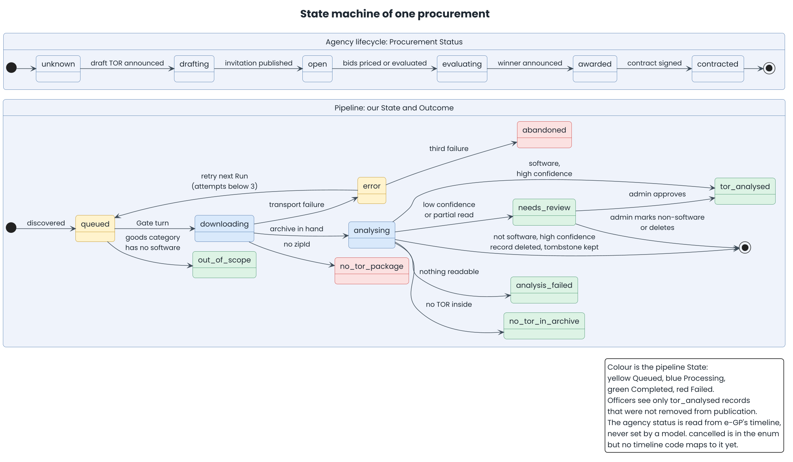

# Diagrams

Five diagrams, kept to the ones that explain something a table cannot.
Simple flows (authentication, request handling, refresh) are written out in the
pages instead. PlantUML sources are in [`src/`](src), with rendered output in
[`png/`](png) (for docs and slides) and [`svg/`](svg) (scalable, searchable text).
The images are committed so they show in any viewer without tooling.

| # | Diagram | Shows | Used in |
| - | ------- | ----- | ------- |
| 01 | [Architecture](png/01-architecture.png) | Users, web, API layers, shared types, and the systems outside | architecture, SRS |
| 02 | [Ingestion flow](png/02-ingestion-flow.png) | One new procurement from the e-GP feed to a decided record | ingestion-flow |
| 03 | [State machine of one procurement](png/03-procurement-state-machine.png) | The pipeline State and Outcome, and the agency's Procurement Status | ingestion-flow, data-model |
| 04 | [Domain model](png/04-domain-model.png) | Entities, key fields, relations, collections | data-model |
| 05 | [Deployment](png/05-deployment.png) | CI, release, Cloud Run, secrets | architecture |



## Regenerating

Needs Java 17+ and `plantuml.jar`. The sources use PlantUML's built-in Smetana
layout, so Graphviz is not required. They use the Poppins font (SIL Open Font
License); install it for your user, or PlantUML falls back to a default sans-serif
and the spacing shifts slightly.

```bash
PLANTUML_JAR=/path/to/plantuml.jar docs/diagrams/render.sh
```

or put a `plantuml` command on `PATH`. The script lifts PlantUML's default 4096 px
image cap, which would otherwise clip the tall ingestion flow.

Edit the `.puml`, never the image. Keep text ASCII. Shared styling is in
`src/style.iuml`. Commit the regenerated `png/` and `svg/` with the source change.
Add a diagram only when a table or a paragraph would be harder to follow.
