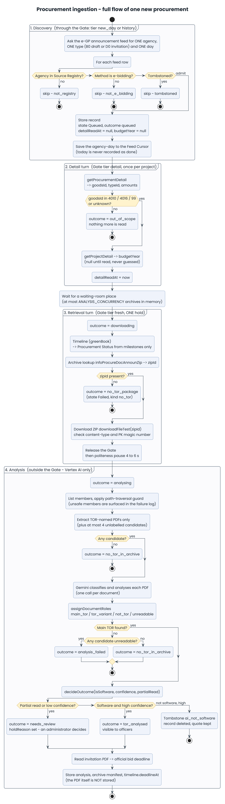

# Procurement retrieval flow

Baseline: `develop` @ `5e622a3`. Source: `apps/api/src/services/egp/*`,
`services/vertex/*` and `services/ingestion.service.ts`. Terms (Run, Gate,
Archive, Waiting room, State, Outcome) are defined in [`CONTEXT.md`](../CONTEXT.md).

Related: [architecture.md](architecture.md), [SRS 4.2 and 4.3](SRS.md#42-announcement-ingestion),
[data-model.md](data-model.md). Diagram sources are in [`diagrams/`](diagrams/README.md).

This page follows one procurement from the e-GP announcement feed to a stored,
decided record, then covers refresh, failure and stopping.

## 1. Overview

A Run has three stages that overlap:

1. Discovery reads the announcement feed and reads each new project's detail.
2. Retrieval reads the project's timeline, looks up its archive and downloads it.
3. Analysis has Gemini read the TOR PDFs and decides what to show.

Discovery and Retrieval talk to e-GP, so they pass through the gate, which allows
one request at a time. Analysis talks only to Vertex AI, so it runs beside them.

## 2. Flow of one new procurement

Points the diagram cannot show:

- The PDF is never stored. Only the archive manifest (`zipId` and the role of each document) survives. When an officer opens the source TOR, the API downloads it again by `zipId` (ADR-0002).
- A dropped record keeps almost nothing: a tombstone with the quoted evidence and a feed snapshot, so an administrator can restore it.
- The invitation is read even for a held record, so an administrator still sees the bid deadline. Only a dropped record skips it.
- Whether the work is software comes from the document, never from the title (ADR-0014). The goods category only limits scope.

## 3. The gate and the queue

The gate serves one section at a time and pauses 4 to 6 seconds after each,
unless nothing else can ask e-GP. When it frees, the best waiting tier goes
next, first come first served within a tier:

| Tier | Work |
| ---- | ---- |
| `new_day` | Discovery reads days since the last Run |
| `detail` | Discovery reads a new project's detail |
| `fresh` | Retrieval of a never-read project |
| `refresh` | Retrieval re-reads a timeline |
| `history` | Discovery backfills the past year, at most 60 feed requests per Run |

A worse tier can wait but not forever, because a Run does not end until its work
is done. A refusal (429 or 403) latches the gate, and every caller, waiting or
arriving later, is refused without touching the site.

The waiting room is the set of archives held in memory while they wait for or
undergo Analysis. It has `ANALYSIS_CONCURRENCY` places (default 8), so a slow
model slows retrieval down instead of piling up memory. A fresh project takes a
place before its turn. A refresh takes none up front.

## 4. Refresh

A refresh re-reads the timeline of a project that was read before, so its status
and deadline stay current. It costs no archive or model call unless the
invitation date moved. Projects due for refresh are those whose Procurement
Status is not `contracted`, oldest check first.

A refresh runs these steps in one gate hold:

1. If `detailReadAt` is null, do the detail turn first. An out-of-scope project stops here as `out_of_scope`.
2. Read the timeline. If e-GP answers `data: null`, keep what the record had and log it.
3. If the project is `drafting`, read the comment deadline.
4. If the invitation date has not moved, save the timeline when it changed (otherwise only `lastReadAt`) and stop. No archive and no model call.
5. If it moved, take a waiting-room place if one is free, look up the `zipId`, download the archive, and have Analysis re-read only the invitation. Then replace the invitation documents and update `timeline.deadlineAt`.

A refresh holds the gate, so it never waits for a waiting-room place. The room
could be full of records that are waiting for that same gate. If no place is free
at that moment, the project goes to the back of the queue untouched.

## 5. Analysis

Analysis lists the archive's member names first and inflates nothing yet. Members
that fail the path-traversal guard are surfaced in the failure log and skipped.
Members that match a TOR filename pattern become candidates, plus at most four
unlabelled ones that are not known boilerplate. Bonds, contracts, forms and the
announcement itself are never read.

Each candidate goes to the model as one call. A PDF over 15 MB is read from its
text layer or its first pages instead (up to 14 MB), or marked unreadable if
neither works. Either fallback counts as a partial read. Afterwards
`assignDocumentRoles` picks one main TOR and marks the rest as variants, not TOR
or unreadable.

`decideOutcome` (`services/egp/decision.ts`) lets only the most certain answers
act on their own:

| Model says | Confidence | Whole PDF read | Result | Visible to officers |
| ---------- | ---------- | -------------- | ------ | ------------------- |
| software | high | yes | `tor_analysed` | yes |
| software | low | any | `needs_review` (`ai_low_confidence`) | no |
| not software | high | yes | dropped, tombstone `ai_not_software` | no |
| not software | low | any | `needs_review` (`ai_not_software_low`) | no |
| any | any | no | `needs_review` (`partial_read`) | no |
| no main TOR found | | | `no_tor_in_archive` | no |
| TOR candidates, none readable | | | `analysis_failed` | no |

The prompt forces low confidence for mixed software and hardware work, a pure
licence or SaaS renewal, unclear scope, and any document that contains
instructions addressed to the reader or the model.

The full lifecycle of a record is below, together with the agency's own status:

## 6. Failures and stopping

What a failed turn does to the record depends on why it failed:

- The gate was latched or closed because the Run is stopping. The record never reached the site, so a fresh one goes back to `queued` and no attempt is spent.
- The site stopped answering. The failure is logged, a fresh record goes back to `queued`, no attempt is spent, and the gate closes.
- e-GP refused with 429 or 403. The gate latches for the rest of the Run, the failure is logged, and a fresh record goes back to `queued` without an attempt spent.
- Anything else, including the 5-minute record deadline, is a transport failure. It is logged with its stage. A refresh keeps its outcome. A fresh record spends an attempt and becomes `error`, then `abandoned` on the third.

| Where it failed | Failure log stage | Effect on the record |
| --------------- | ----------------- | -------------------- |
| A feed request for an agency-day | `discovery` | The day is not added to the Feed Cursor and is asked again next Run |
| Detail answered `data: null` | `discovery` | Left as it was, `detailReadAt` stays null, asked again |
| Timeline answered `data: null` | `timeline` | Keeps what it had, Procurement Status unchanged |
| An unrecognised announcement code | `timeline` | Logged, status not changed by it |
| No `zipId` | `info`, kind `no_tor` | `no_tor_package` (Failed), a legitimate upstream answer |
| Lookup or download error | `info` or `download` | An attempt is spent: `error`, then `abandoned` on the third |
| A path-traversal archive member | `extract` | Surfaced in the log and skipped |
| An archive with no TOR | `extract`, kind `no_tor` | `no_tor_in_archive` |
| The model could not read any candidate | `analysis` | `analysis_failed`, not retried because archives are not stored |

A Run ends when its work is done or the gate closes: a refusal, three unanswered requests in a row, a web page served in place of data, an administrator's stop, or a lost lease. After that nothing new goes to e-GP, Analysis finishes the archives it holds, and queued projects keep their state.

## 7. Requests made to e-GP

Every request an ingestion Run makes goes through the gate, and the Run sends nothing else to
`gprocurement.go.th`.

**Open compliance gap.** The on-demand source download (`GET /api/tors/:projectId/source`, through
`TorService.source()`) calls `downloadArchive` directly and does not use the gate. The gate is
created inside each Run, so concurrent source downloads can overlap each other and a Run, and a
Run's latched gate does not stop them.

| Request | Made by | Tier | When | Notes |
| ------- | ------- | ---- | ---- | ----- |
| Announcement RSS feed (agency, type, day) | Discovery | `new_day`, `history` | Every sweep | One agency, one type, one day. No token or captcha. 20 s timeout, no retries |
| `getProcurementDetail` | Detail turn | `detail` | Until `detailReadAt` is set | Goods category decides scope |
| `getProjectDetail` | Detail turn | `detail` | While `budgetYear` is null | Never guessed |
| Draft list (comment deadline) | Detail or refresh | `detail`, `refresh` | Only while `drafting` | |
| Timeline (greenBook) | Retrieval | `fresh`, `refresh` | Every turn | Source of Procurement Status |
| `infoProcureDocAnnounZip?projectId=` | Retrieval | `fresh`, `refresh` | A new project, or a moved invitation | `data.zipId`; absent means no TOR package |
| `downloadFileTest?fileId=<zipId>` | Retrieval | `fresh`, `refresh` | Same | ZIP up to about 30 MB, 120 s timeout |

The `process5` project search is never called, and the code must not gain a
captcha solver, a copied browser token or a headless browser to reach it.

## 8. What is kept

| Data | Kept | Where |
| ---- | ---- | ----- |
| Feed fields (name, agency, announce date, method) | yes | `procurements` |
| Detail fields (goods category, budget year, amounts) | yes | `procurements` |
| Timeline, Procurement Status, deadlines | yes | `procurements.timeline` |
| Archive manifest (`zipId`, member names, roles, read mode) | yes | `procurements.archive` |
| AI analysis and its `promptVersion` | yes | `procurements.analysis` |
| TOR PDF bytes | no | Memory only, re-downloaded on request |
| A record judged non-software with high confidence | deleted | A tombstone remains: reason, quoted evidence, prompt version, feed snapshot |
| Failures | yes | `ingestion_failures` |
| Status history | last 50 entries | `procurements.statusHistory` |
| Run summaries | yes | `ingestion_runs` |
