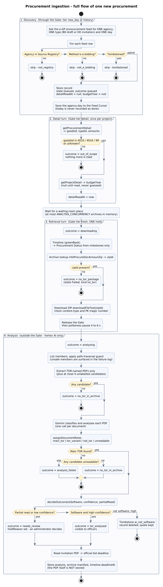
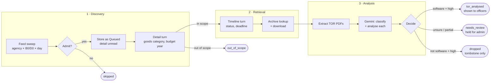
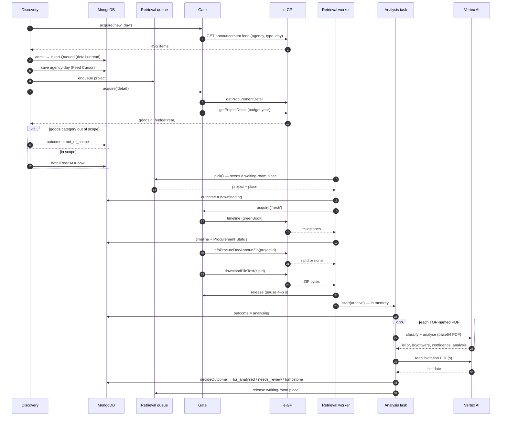
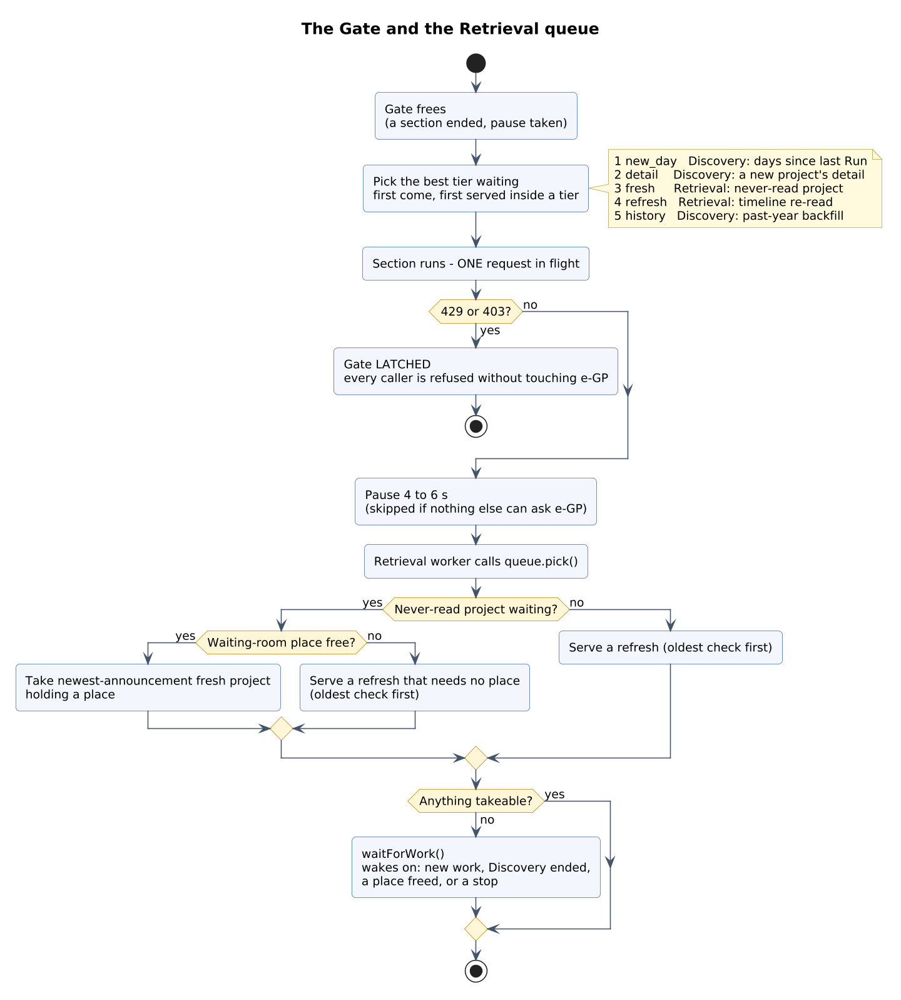
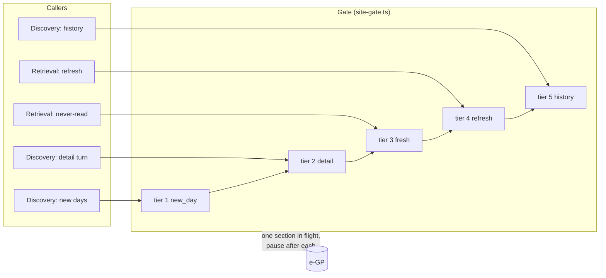
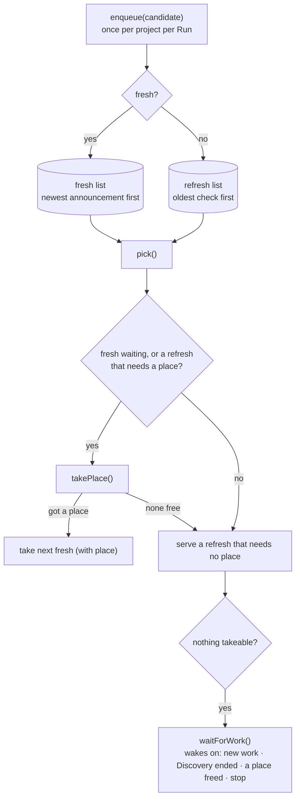
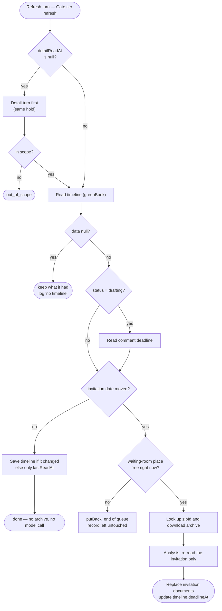
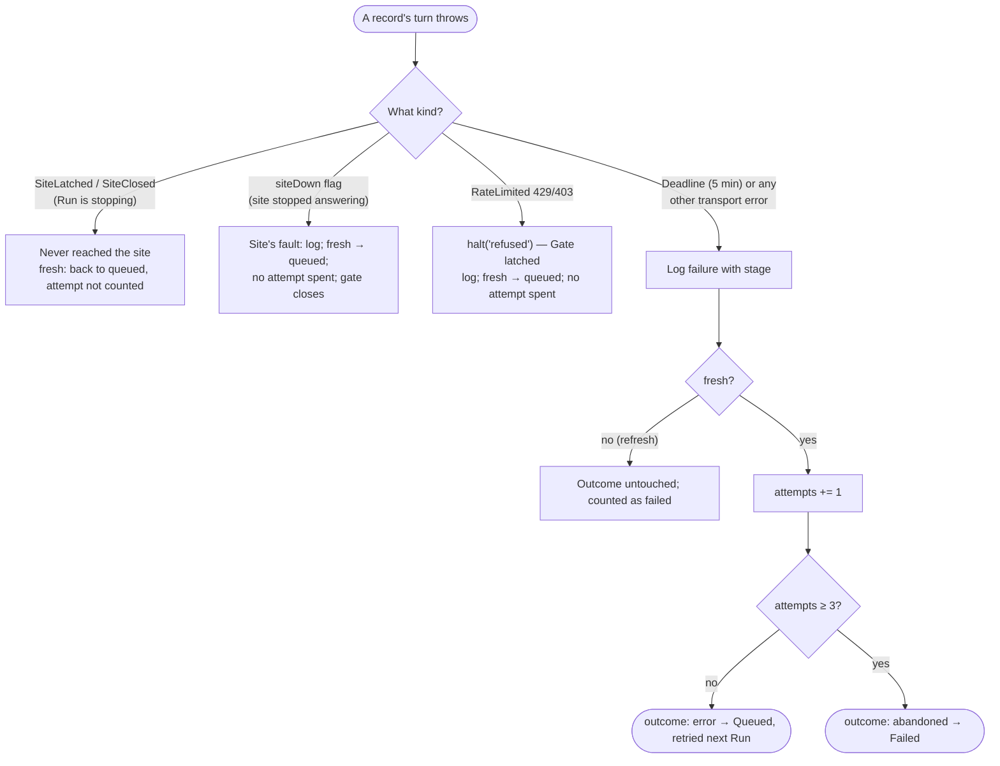

# Procurement retrieval — full flow

|              |                                                                                  |
| ------------ | -------------------------------------------------------------------------------- |
| **Version**  | 0.1 (draft)                                                                      |
| **Baseline** | `develop` @ `5e622a3`                                                            |
| **Source**   | `apps/api/src/services/egp/*`, `services/vertex/*`, `services/ingestion.service.ts` |
| **Related**  | [architecture.md §6](architecture.md#6-runtime-view) · [SRS §4.2–4.3](SRS.md#42-announcement-ingestion) · [data-model.md](data-model.md) · [`CONTEXT.md`](../CONTEXT.md) |

This page follows **one procurement from the e-GP announcement feed to a stored,
decided record**, then shows the other paths (refresh, failure, stop). Terms
(Run, Gate, Archive, Waiting room, State, Outcome) are defined in
[`CONTEXT.md`](../CONTEXT.md).

> **Rendered images** (PlantUML, [all diagrams](diagrams/README.md)): the full flow below, the
> [sequence](diagrams/png/04-ingestion-sequence.png), [refresh](diagrams/png/05-refresh-flow.png),
> [failure handling](diagrams/png/06-failure-handling.png), [document analysis](diagrams/png/07-document-analysis.png),
> [state lifecycle](diagrams/png/08-outcome-lifecycle.png) and [gate and queue](diagrams/png/18-gate-and-queue.png).



Contents: [1 Map](#1-the-map) · [2 End-to-end flow](#2-end-to-end-flow-of-one-new-procurement) ·
[3 Sequence](#3-sequence-who-talks-to-whom) · [4 Gate and queue](#4-the-gate-and-the-queue) ·
[5 Refresh](#5-refreshing-a-procurement-already-read) · [6 Analysis](#6-analysis-in-detail) ·
[7 Failures](#7-failure-handling) · [8 Requests made](#8-every-request-made-to-e-gp) ·
[9 Kept vs discarded](#9-what-is-kept-and-what-is-discarded)

## 1. The map



Stages 1–2 talk to e-GP and therefore pass through the **Gate** (one request at
a time). Stage 3 talks only to Vertex AI, so it overlaps the others.

## 2. End-to-end flow of one new procurement

```mermaid
flowchart TD
    start([Run starts<br/>lease acquired]) --> sweep

    subgraph D[Discovery — feed sweep, through the Gate]
        sweep["Ask feed: one agency · one type (B0 draft / D0 invitation) · one day<br/>order: new days → history (≤ 60 requests/Run)"]
        sweep --> row[/"Each feed row"/]
        row --> a1{"Agency in<br/>Source Registry?"}
        a1 -- no --> skip1([skip: not_registry])
        a1 -- yes --> a2{"Method is<br/>e-bidding?"}
        a2 -- no --> skip2([skip: not_e_bidding])
        a2 -- yes --> a3{"Tombstoned?"}
        a3 -- yes --> skip3([skip: tombstoned])
        a3 -- no --> store1["Store record<br/>state Queued · outcome queued<br/>detailReadAt = null · budgetYear = null"]
        store1 --> cursor["Save agency-day to the Feed Cursor<br/>(today is never recorded as done)"]
    end

    store1 --> q1[("Retrieval queue")]

    subgraph DT["Detail turn — Gate tier 'detail', once per project (ADR-0021)"]
        q1 --> d1["getProcurementDetail → goodsId, typeId, deptSubName, amounts"]
        d1 --> d2{"goodsId in 4010 / 4016 / 99<br/>or unknown?"}
        d2 -- no --> oos(["outcome: out_of_scope<br/>nothing more is read"])
        d2 -- yes --> d3["getProjectDetail → budgetYear"]
        d3 --> d4["detailReadAt = now<br/>(draft only: read comment deadline)"]
    end

    d4 --> wr{"Waiting-room place free?<br/>(≤ ANALYSIS_CONCURRENCY)"}
    wr -- "no: wait; Gate serves refreshes meanwhile" --> wr
    wr -- yes --> t0

    subgraph RT["Retrieval turn — Gate tier 'fresh', one hold"]
        t0["Mark downloading"] --> t1["Timeline (greenBook)"]
        t1 --> t2["Derive Procurement Status from milestones<br/>drafting · open · evaluating · awarded · contracted · cancelled"]
        t2 --> t3["Archive lookup: infoProcureDocAnnounZip → zipId"]
        t3 --> t4{"zipId present?"}
        t4 -- no --> ntp(["outcome: no_tor_package<br/>state Failed, kind no_tor"])
        t4 -- yes --> t5["Download ZIP: downloadFileTest(zipId)<br/>check content-type and PK magic"]
        t5 --> rel["Release Gate + politeness pause 4–6 s"]
    end

    rel --> an1

    subgraph AN["Analysis — outside the Gate, Vertex AI only"]
        an1["Mark analysing · list members<br/>path-traversal guard"] --> an2["Extract TOR-named PDFs only<br/>(≤ 4 unlabelled candidates)"]
        an2 --> an3{"Any candidate?"}
        an3 -- no --> nti(["outcome: no_tor_in_archive"])
        an3 -- yes --> an4["Gemini: classify + analyse each PDF<br/>(one call per document)"]
        an4 --> an5["assignDocumentRoles<br/>main_tor · tor_variant · not_tor · unreadable"]
        an5 --> an6{"Main TOR found<br/>and readable?"}
        an6 -- "none readable" --> af(["outcome: analysis_failed"])
        an6 -- no TOR --> nti
        an6 -- yes --> dec{"decideOutcome<br/>(isSoftware, confidence, partialRead)"}
        dec -- "software + high<br/>+ whole PDF" --> show(["outcome: tor_analysed<br/>visible to officers"])
        dec -- "low confidence<br/>or partial read" --> hold(["outcome: needs_review<br/>holdReason set"])
        dec -- "not software + high<br/>+ whole PDF" --> drop(["tombstone: ai_not_software<br/>record deleted"])
        show --> inv["Read invitation → official bid deadline"]
        hold --> inv
        inv --> save[("Store analysis, archive manifest,<br/>timeline.deadlineAt")]
    end
```



Notes that are easy to miss:

- **The PDF itself is never stored.** Only the Archive manifest (`zipId` and per-document roles) survives. Officers who open the source TOR trigger a fresh download by `zipId` (ADR-0002).
- **A dropped record keeps almost nothing**: a tombstone with the quote that justified it and a feed snapshot, so an administrator can restore it.
- **The invitation is read even for a held record** so an administrator still sees the deadline; it is skipped only for a dropped record.
- **Software-ness comes from the document, never from the title** (ADR-0014). The goods-category check only limits scope.

## 3. Sequence: who talks to whom



## 4. The Gate and the queue

### 4.1 One request at a time, best tier first






- At most **one** site section in flight, platform-wide; a pause (4–6 s, randomised) follows unless nothing else is waiting.
- When it frees, the **best tier waiting** goes next; first come, first served within a tier. A worse tier can wait but not forever, since a Run does not end until its work is done.
- A **refusal (429/403) latches** it: every caller, waiting or arriving later, is refused without touching the site.

### 4.2 Queue and waiting room



The **waiting room** is the set of Archives held in memory, waiting for or under
Analysis. It has `ANALYSIS_CONCURRENCY` places (default 8). It is what makes a
slow model slow the site traffic **down** rather than pile up memory.

## 5. Refreshing a procurement already read

A refresh re-reads the timeline of a project that has been read before, so its
status and deadline stay current. It costs no archive or model call unless the
invitation date moved.



Which projects are refreshed: those already read whose Procurement Status is not
`contracted`, **oldest check first**. A refresh never takes a waiting-room place
up front, because it holds the Gate and the room could be full of records
waiting for that very Gate.

## 6. Analysis in detail

```mermaid
flowchart TD
    z["ZIP in memory"] --> l["List member names<br/>(nothing inflated yet)"]
    l --> g{"Member name passes<br/>path-traversal guard?"}
    g -- no --> note["Surface in failure log<br/>never silently dropped"]
    g -- yes --> m{"Name matches a TOR pattern<br/>(canonical / loose)?"}
    m -- yes --> cand["Candidate"]
    m -- no --> u{"Not a known boilerplate member<br/>(bonds, contracts, forms, announcement)?"}
    u -- yes --> unl["Unlabelled candidate<br/>(at most 4)"]
    u -- no --> ign["Ignored — never read"]
    cand --> infl["Inflate only chosen members"]
    unl --> infl
    infl --> sz{"PDF ≤ 15 MB?"}
    sz -- yes --> pdf["Send whole PDF (base64)<br/>readMode: pdf"]
    sz -- no --> ov{"Oversize fallback"}
    ov --> txt["Text layer → readMode: text"]
    ov --> fp["First pages ≤ 14 MB → readMode: first_pages"]
    ov --> unr["None possible → unreadable"]
    pdf --> call["Gemini returns<br/>isTor · torKind · analysis · judgement"]
    txt --> call
    fp --> call
    call --> roles["assignDocumentRoles<br/>pick one main TOR; mark variants,<br/>not-TOR, ambiguity"]
    roles --> dec["decideOutcome"]
```

**Decision table** (`services/egp/decision.ts`; only the most certain answers act on their own):

| Model says | Confidence | Whole PDF read? | Result | Officers see it? |
| ---------- | ---------- | --------------- | ------ | ---------------- |
| software | high | yes | `tor_analysed` | **yes** |
| software | low | — | `needs_review` (`ai_low_confidence`) | no |
| not software | high | yes | dropped, tombstone `ai_not_software` | no |
| not software | low | — | `needs_review` (`ai_not_software_low`) | no |
| anything | any | **no** (text / first pages) | `needs_review` (`partial_read`) | no |
| no main TOR found | — | — | `no_tor_in_archive` | no |
| TOR candidates, none readable | — | — | `analysis_failed` | no |

The prompt forces `low` confidence for: mixed software + hardware work, a pure
licence or SaaS renewal, unclear scope, and any document that contains
instructions addressed to the reader or model (prompt-injection defence).

## 7. Failure handling



| Where it failed | Failure-log stage | Effect on the record |
| --------------- | ----------------- | -------------------- |
| Feed request for an agency-day | `discovery` | Day not added to the Feed Cursor; asked again next Run |
| Detail turn (`data: null`) | `discovery` | Left as it was; `detailReadAt` stays null; asked again |
| Timeline (`data: null`) | `timeline` | Keeps what it had; Procurement Status not changed |
| Unknown announcement code in timeline | `timeline` | Logged; status not changed by it |
| No `zipId` | `info` (kind `no_tor`) | `no_tor_package` (Failed) — a legitimate upstream answer |
| Download / lookup error | `info` / `download` | Attempt spent; `error` or `abandoned` |
| Path-traversal member | `extract` | Surfaced in the log; member skipped |
| Archive has no TOR | `extract` (kind `no_tor`) | `no_tor_in_archive` |
| Model could not read any candidate | `analysis` | `analysis_failed` (Completed; **not** retried: archives are not stored) |

## 8. Every request made to e-GP

All inside the Gate. Nothing else is ever sent to `gprocurement.go.th`.

| # | Request | Made by | Tier | When | Notes |
| - | ------- | ------- | ---- | ---- | ----- |
| 1 | Announcement RSS feed (agency × type × day) | Discovery | `new_day` / `history` | Every sweep | One agency, one type, one day. No token or captcha. 20 s timeout, no retries |
| 2 | `getProcurementDetail` | Detail turn | `detail` | Until `detailReadAt` is set | Goods category decides scope; draft-list parameters |
| 3 | `getProjectDetail` | Detail turn | `detail` | While `budgetYear` is null | Never guessed; null until read |
| 4 | Draft list (comment deadline) | Detail / refresh | `detail` / `refresh` | Only when status is `drafting` | |
| 5 | Timeline (greenBook) | Retrieval | `fresh` / `refresh` | Every turn | Source of Procurement Status |
| 6 | `infoProcureDocAnnounZip?projectId=` | Retrieval | `fresh` / `refresh` | New project, or invitation moved | `data.zipId`; absent means no TOR package |
| 7 | `downloadFileTest?fileId=<zipId>` | Retrieval | same | same | ZIP up to ~30 MB, 120 s timeout |

Never called: the `process5` project search (Cloudflare Turnstile). Never added:
a captcha solver, a copied browser token or a headless browser.

## 9. What is kept and what is discarded

| Data | Kept? | Where |
| ---- | ----- | ----- |
| Feed fields (name, agency, announce date, method) | yes | `procurements` |
| Detail fields (goods category, budget year, amounts) | yes | `procurements` |
| Timeline, Procurement Status, deadlines | yes | `procurements.timeline` |
| Archive manifest (`zipId`, member names, roles, read mode) | yes | `procurements.archive` |
| AI analysis (summary, scope, budget, tech stack, …) and `promptVersion` | yes | `procurements.analysis` |
| **TOR PDF bytes** | **no** | In memory only; re-downloaded on demand |
| Records judged non-software with high confidence | **deleted** | Only a tombstone: reason, quoted evidence, prompt version, feed snapshot |
| Failures | yes | `ingestion_failures` |
| Per-record status history | last 50 entries | `procurements.statusHistory` |
| Run summaries | yes | `ingestion_runs` |
