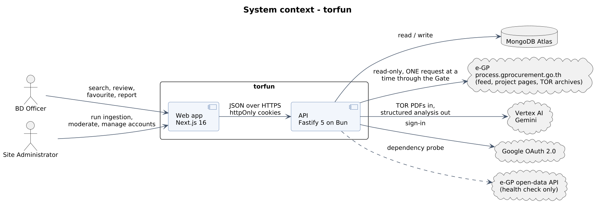

# System requirements

Technical requirements read from the code, one layer below the product-level
[SRS](SRS.md). They cover the pipeline, the gate, security, reliability and data,
and they have their own IDs (FR-AUTH-01, NFR-UP-03, ...). Where this page and the
SRS overlap, the SRS ID is authoritative. Scope, user stories and the glossary are
in the SRS; the vocabulary is defined in [`CONTEXT.md`](../CONTEXT.md).

Baseline: `develop` @ `5e622a3`. Version 0.1, draft for team review. The structure
follows ISO/IEC/IEEE 29148:2018.

Each requirement has a stable ID, a priority (M must, S should, C could) and a
status against the baseline: I implemented, P partial, PL planned. A requirement
the code does not yet meet is marked planned instead of omitted, so the gap shows.

Related: [architecture.md](architecture.md), [data-model.md](data-model.md),
[ingestion-flow.md](ingestion-flow.md), [api.md](api.md).

## 1. Introduction

### 1.1 Abbreviations

Terms not defined in the SRS glossary:

| Term | Meaning |
| ---- | ------- |
| Discovery, Retrieval, Analysis | The three pipeline stages that overlap inside a Run |
| Gate | The single path a Run uses to reach e-GP: one request at a time, with a pause after each |
| Source Registry | The fixed list of agencies collected under |
| Tombstone | A record that a project was judged non-software and must not be ingested again |
| State, Outcome | The pipeline lifecycle (Queued, Processing, Completed, Failed) and its finer reason |
| Procurement Status | The agency's own lifecycle position, from `drafting` to `contracted` or `cancelled` |
| ADC | Google Application Default Credentials |

### 1.2 References

| Ref | Document |
| --- | -------- |
| R1 | [`CONTEXT.md`](../CONTEXT.md), the domain vocabulary |
| R2 | [`AGENTS.md`](../AGENTS.md) and the per-app `AGENTS.md` files, for product intent and guardrails |
| R3 | The root and per-app `README.md` files, for setup, endpoints and pages |
| R4 | ISO/IEC/IEEE 29148:2018, Requirements engineering |
| R5 | ADR-0002, -0004, -0006, -0007, -0009, -0015, -0018, -0020 and -0021, cited in the code but not on this branch (OI-02) |

## 2. Overall description

### 2.1 Product perspective

torfun is a web system with two deployable services and one shared contract
package, and it depends on e-GP, Vertex AI, Google OAuth and MongoDB Atlas.

### 2.2 User classes

| Class | Role value | Sees | Does |
| ----- | ---------- | ---- | ---- |
| BD Officer | `business_development_officer` | Procurements whose TOR was read and approved for display | Searches, reads, favourites, reports TORs, keeps the Company record |
| Site Administrator | `admin` | The full queue, including held and failed records | Runs ingestion, moderates, manages accounts. Never holds a Company |

Self-registration always creates a BD Officer. Admin is never self-claimed: an
existing administrator grants it (`PATCH /api/admin/users/:id`), and the first
administrator is set in the database (FR-AUTH-04).

### 2.3 Operating environment

- Web: modern evergreen browsers; UI in Thai with English technical terms.
- API: Bun 1.3.x, Fastify 5. Web: Next.js 16 (App Router), React 19.
- Data: MongoDB Atlas (8.0 locally through `mongodb-atlas-local`).
- AI: Vertex AI, default model `gemini-3.5-flash`, region `asia-southeast1`.
- Hosting: Google Cloud Run, with images in Artifact Registry.

### 2.4 Design and implementation constraints

| ID | Constraint |
| -- | ---------- |
| CON-01 | Upstream access is conditional. `gprocurement.go.th` publishes `robots.txt: Disallow: /`, and the project operates under a research authorisation whose limits are not recorded in the repository. The system stays low impact: single-file requests, a pause after each, and an abort on refusal |
| CON-02 | The `process5` project search is never called, and no captcha solver, copied browser token or headless browser may be used to reach it |
| CON-03 | No service-account keys exist (organisation policy). Google access uses impersonation, ADC or the Cloud Run runtime identity |
| CON-04 | Scope is software procurement through e-bidding only |
| CON-05 | TOR archives are not persisted. They are held in memory only while analysed |
| CON-06 | Shared domain types live in `packages/types` (zod). The wire format is snake_case and domain objects are camelCase |
| CON-07 | The API layering `routes`, `services`, `repositories`, `core` is enforced by ESLint |

### 2.5 Assumptions and dependencies

- e-GP keeps publishing the announcement RSS feed and the project-detail and timeline (greenBook) endpoints in their current shape. A change breaks ingestion (R-01).
- The research authorisation to read e-GP remains valid.
- Vertex AI quota supports `ANALYSIS_CONCURRENCY` concurrent calls.
- Gemini reads Thai TOR PDFs natively. Very large files are read partially and then held for review (FR-ING-14).

## 3. Functional requirements

Priority: M must, S should, C could. Status: I implemented, P partial, PL planned.

### 3.1 Authentication and accounts (AUTH)

| ID | Requirement | Pri | Status |
| -- | ----------- | --- | ------ |
| FR-AUTH-01 | A visitor shall be able to register with username, first/last name and password. | M | I |
| FR-AUTH-02 | A user shall be able to sign in with username/password. | M | I |
| FR-AUTH-03 | A user shall be able to sign in with Google (OAuth 2.0); the callback redirects into the web app. | M | I |
| FR-AUTH-04 | Self-registration shall always create a `business_development_officer`. The `admin` role shall be assignable only by an existing administrator (not on their own account; the last active administrator cannot be demoted or deactivated) or directly in the database. | M | I |
| FR-AUTH-05 | Sessions shall use a short-lived access JWT (15 min) and a long-lived refresh token (30 days), both in `httpOnly` cookies. | M | I |
| FR-AUTH-06 | Refresh tokens shall rotate on use; presenting a revoked or reused token shall revoke the whole token family. | M | I |
| FR-AUTH-07 | Credential endpoints shall be throttled per IP (30 / 15 min) and per account (10 / 15 min). | M | I |
| FR-AUTH-08 | An administrator shall be able to list accounts, activate or deactivate an account, and grant or revoke the `admin` role. | S | I |
| FR-AUTH-09 | A deactivated account shall be unable to sign in or refresh. | M | I |
| FR-AUTH-10 | A signed-in officer without a Company shall be directed to the Company-setup flow before using protected pages (administrators exempt). | S | I |

### 3.2 Vendor record (VEN)

| ID | Requirement | Pri | Status |
| -- | ----------- | --- | ------ |
| FR-VEN-01 | An officer shall be able to search existing Companies by Thai name (typeahead) and join one, or create a new one. | M | I |
| FR-VEN-02 | A Company name shall be Thai-only (contain Thai script, no Latin letters); a TIN, if given, shall be exactly 13 digits. | M | I |
| FR-VEN-03 | An officer shall be able to correct their own Company. | S | I |
| FR-VEN-04 | An officer shall be able to record, edit and delete Clients (government or private) of their Company; deletion shall be refused while Experience is recorded against the Client. | M | I |
| FR-VEN-05 | Client name suggestions shall be offered from agency names already seen. | C | I |
| FR-VEN-06 | An officer shall be able to record, edit and delete Experience: Client and project name required; description, tech stack, target platforms and duration optional. | M | I |
| FR-VEN-07 | Experience shall use the same vocabulary a TOR is analysed into (tech stack, target platform) so that the two are comparable. | M | I |
| FR-VEN-08 | Clients and Experience shall be scoped to the officer's Company; one officer shall not read or alter another Company's record. | M | I |

### 3.3 Discovering procurements (DISC)

| ID | Requirement | Pri | Status |
| -- | ----------- | --- | ------ |
| FR-DISC-01 | A signed-in user shall be able to list procurements with pagination (`limit` ≤ 200, default 50). | M | I |
| FR-DISC-02 | The list shall be filterable by free-text query, agency, budget year, Procurement Status, budget range, published-date range, deadline range, and minimum days left (Thai calendar days). | M | I |
| FR-DISC-03 | The list shall be filterable by tech stack, target platform and an industry keyword. | S | I |
| FR-DISC-04 | `minDaysLeft` and an explicit deadline range shall be mutually exclusive; every range's maximum shall be ≥ its minimum. | M | I |
| FR-DISC-05 | A user shall be able to open one procurement and see its summary, scope of work, budget, deadline, tech stack, target platforms, required qualifications and lifecycle timeline. | M | I |
| FR-DISC-06 | A user shall be able to download or view the original TOR PDF of a procurement so that AI output can be verified against the source. | M | I |
| FR-DISC-07 | Officers shall see only procurements whose TOR was read and shown (`tor_analysed`) and not removed from publication; administrators shall see every record. | M | I |
| FR-DISC-08 | Fields that are an administrator's business (who approved a record, why it was held) shall be blanked for officers. | M | I |
| FR-DISC-09 | The public `/search` page shall accept a query from a guest and tell them what access the index needs, rather than discarding the query. | S | P |
| FR-DISC-10 | The system shall present a match score of each procurement against the officer's Company Experience, with a breakdown (tech stack, deadline, industry, target platform, decision rules). | M | PL |
| FR-DISC-11 | Each user shall be able to record a personal Review Status (their own judgement) on a procurement, without affecting what colleagues see. | S | PL |

> Note (FR-DISC-09, FR-DISC-10). `/search` is reachable by guests, but the
> list endpoint requires authentication. `MatchResult` exists in
> `packages/types` as a placeholder keyed on `projectId` only; it must gain a
> company key before scoring is built, or one vendor's score would be shown to
> another (see `matching.ts`, ADR-0007).

### 3.4 Favourites (FAV)

| ID | Requirement | Pri | Status |
| -- | ----------- | --- | ------ |
| FR-FAV-01 | An officer shall be able to favourite and un-favourite a procurement they can see. | M | I |
| FR-FAV-02 | Favourites shall be personal to the account; colleagues in the same Company shall not see them. | M | I |
| FR-FAV-03 | The favourites list shall exclude procurements the user can no longer see (e.g. removed from publication). | M | I |
| FR-FAV-04 | Favouriting a procurement the caller cannot see shall fail with `404`. | M | I |

### 3.5 TOR reports (REP)

| ID | Requirement | Pri | Status |
| -- | ----------- | --- | ------ |
| FR-REP-01 | A user shall be able to report a TOR with a reason (`unreasonable_requirements`, `incorrect_information`, `outdated`, `invalid_document`, `other`) and optional details (≤ 2000 chars); details are mandatory for `other`. | M | I |
| FR-REP-02 | An administrator shall see a shared report queue (default filter: pending), newest first, paginated. | M | I |
| FR-REP-03 | An administrator shall be able to dismiss a report or remove the TOR from publication, optionally with a note; the decision, reviewer and time shall be recorded. | M | I |
| FR-REP-04 | A TOR removed from publication shall disappear from officers' search and favourites. | M | I |

### 3.5.1 Notifications (NOT)

| ID | Requirement | Pri | Status |
| -- | ----------- | --- | ------ |
| FR-NOT-01 | An officer shall be notified of relevant changes (e.g. a favourited procurement's status or deadline moves). | C | PL |

A `feature/notifications` branch exists upstream; nothing is on `develop`.

### 3.6 Ingestion pipeline (ING)

| ID | Requirement | Pri | Status |
| -- | ----------- | --- | ------ |
| FR-ING-01 | Discovery. A Run shall read the e-GP announcement feed one agency × announcement type (draft TOR `B0`, invitation `D0`) × day per request, over the Source Registry, and admit e-bidding projects that have no tombstone. | M | I |
| FR-ING-02 | Discovery shall never consult the project title to admit or reject a project. | M | I |
| FR-ING-03 | Discovery shall read days since the last Run first (new days always read in full), then a bounded share of history (`FEED_BACKFILL_REQUESTS_PER_RUN`, default 60 requests per Run, back `FEED_HISTORY_DAYS` = 365), tracked by a per-agency/type Feed Cursor. Today is re-read and never recorded as done. | M | I |
| FR-ING-04 | A new project shall be stored as `Queued` from the feed alone and handed to Retrieval immediately. | M | I |
| FR-ING-05 | Retrieval. For each project, in one Gate turn, the system shall read project detail (until read once), the announcement timeline (greenBook), then locate and download the announcement archive and extract TOR PDFs. | M | I |
| FR-ING-06 | Retrieval shall serve never-read projects first (newest announcement first), then re-read the timeline of already-read, non-`contracted` projects, oldest check first; an unchanged timeline shall cost no archive or model call, and a moved invitation date shall re-read the invitation alone. | M | I |
| FR-ING-07 | Procurement Status shall be derived only from timeline milestones; no model output shall set it. | M | I |
| FR-ING-08 | The budget year shall be left empty until read from project detail, never guessed. | M | I |
| FR-ING-09 | Analysis. Each downloaded Archive shall be classified per document (main TOR, TOR variant, not-TOR, invitation, bidding document, unreadable) by reading the document, never by filename. | M | I |
| FR-ING-10 | Analysis shall extract: summary, scope of work, budget (THB), bid deadline, duration (days), tech stack, target platforms, required qualifications; unknowns shall be `null`/empty, never guessed. | M | I |
| FR-ING-11 | Analysis shall judge `isSoftware` with a confidence of `high` or `low` and a Thai one-line reason quoting the document (≤ 200 chars); mixed hardware/software, licence-only/SaaS and unclear scope shall always be `low`. | M | I |
| FR-ING-12 | Each analysis shall record the prompt version that produced it. | S | I |
| FR-ING-13 | Document text shall be treated as data: instructions embedded in a TOR shall not be followed, and shall force `low` confidence. | M | I |
| FR-ING-14 | Decision. Only a confident, whole-document answer shall act: _software + high_ → shown to officers; _not software + high_ → dropped and tombstoned; everything else, and any partial read, → held (`needs_review`) with a hold reason. | M | I |
| FR-ING-15 | A project whose Goods Category carries no software work shall be kept as `out_of_scope` and nothing further read for it (ADR-0021). | S | I |
| FR-ING-16 | A project publishing no TOR (`no_tor_package`, `no_tor_in_archive`) shall be recorded as a legitimate upstream answer, distinct from a failure, and surfaced to administrators. | M | I |
| FR-ING-17 | Transport failures shall requeue a record up to `MAX_RETRIEVAL_ATTEMPTS` (3), after which it is `abandoned`. A record shall have a per-record deadline of 5 minutes (`RECORD_DEADLINE_MS`). | M | I |
| FR-ING-18 | Records whose analysis failed shall not be retried automatically (archives are not stored). | M | I |
| FR-ING-19 | Every failure shall be written to an administrator-visible failure log with stage (`discovery`, `timeline`, `info`, `download`, `extract`, `analysis`) and kind (`fault` / `no_tor`); failures shall never be swallowed. | M | I |
| FR-ING-20 | Path-traversal members found in an archive shall be surfaced, not dropped. | M | I |
| FR-ING-21 | Each record shall keep a bounded status history (last 50 changes). | C | I |
| FR-ING-22 | Ingested data shall come only from a real Run; the system shall not seed, mock or backfill procurement records otherwise. | M | I |

### 3.7 Run control and scheduling (RUN)

| ID | Requirement | Pri | Status |
| -- | ----------- | --- | ------ |
| FR-RUN-01 | An administrator shall be able to start a Run (`202`; `409` if one is live). | M | I |
| FR-RUN-02 | Only one Run shall execute at a time across all API instances (database-backed lease). | M | I |
| FR-RUN-03 | An administrator shall be able to stop a running Run; Analysis shall finish the Archives it already holds, nothing new shall be requested from e-GP. | M | I |
| FR-RUN-04 | A rate-limit or forbidden response from e-GP (429/403) shall close the Gate for the rest of the Run. | M | I |
| FR-RUN-05 | `SITE_UNREACHABLE_AFTER` (3) consecutive unanswered requests, or a lookup answered with a web page instead of data (site closed notice), shall close the Gate. | M | I |
| FR-RUN-06 | The Gate shall allow one upstream request in flight, with a randomised pause (4–6 s) after each, serving tiers in priority order: new days → never-read → refresh → history. | M | I |
| FR-RUN-07 | Model calls in flight shall be bounded by `ANALYSIS_CONCURRENCY` (default 8, max 32); the in-memory "waiting room" shall have that many places, and Retrieval of new projects shall wait while it is full. | M | I |
| FR-RUN-08 | An administrator shall be able to configure an automatic schedule: either every _N_ hours (6 ≤ N ≤ 168) or chosen weekdays at a time of day (Asia/Bangkok). Default: disabled. | M | I |
| FR-RUN-09 | The schedule view shall show last run, next run and the next few upcoming runs. | S | I |
| FR-RUN-10 | Finished Runs shall be recorded (history, outcome counts, trends) and exposed to the admin console. | S | I |
| FR-RUN-11 | An administrator shall be able to view live work in progress (current gate holder, per-project stage). | S | I |
| FR-RUN-12 | No volume cap shall apply within a Run beyond the above (owner's decision, ADR-0015); how often Runs start (the schedule floor) is the volume control. | M | I |

### 3.8 Moderation (MOD)

| ID | Requirement | Pri | Status |
| -- | ----------- | --- | ------ |
| FR-MOD-01 | An administrator shall be able to approve a held record, making it visible to officers; approver and time are recorded. | M | I |
| FR-MOD-02 | An administrator shall be able to mark a record non-software, producing a tombstone. | M | I |
| FR-MOD-03 | An administrator shall be able to read anyway a record that was out of scope. | S | I |
| FR-MOD-04 | An administrator shall be able to delete a record with or without a tombstone. | M | I |
| FR-MOD-05 | An administrator shall be able to list tombstones and remove one, or restore a tombstoned project; restore runs as a one-project Run that rebuilds the record from the feed snapshot the tombstone kept. | M | I |
| FR-MOD-06 | Administrator overrides shall sit outside the officer visibility rule and be attributed to the administrator. | M | I |

### 3.9 Administration and operations views (ADM)

| ID | Requirement | Pri | Status |
| -- | ----------- | --- | ------ |
| FR-ADM-01 | An administrator shall see an ingestion summary: counts by State and Outcome, and by agency. | M | I |
| FR-ADM-02 | An administrator shall be able to list and filter all procurements by state, outcome, agency, year, status etc. | M | I |
| FR-ADM-03 | An administrator shall have a dashboard with KPIs, outcome breakdown, trends, an approval queue, system health and recent activity. | S | I |
| FR-ADM-04 | An administrator shall be able to check live dependency health (database, Vertex AI, open-data). | S | I |
| FR-ADM-05 | A public liveness endpoint shall touch no external dependency. | M | I |

## 4. External interface requirements

### 4.1 User interfaces

| Route | Access | Purpose |
| ----- | ------ | ------- |
| `/` | public | Landing page with search field as hero |
| `/search` | public | Results for `?q=` |
| `/login`, `/register`, `/signup` | public | Sign-in / self-registration |
| `/company-experiences` | user | Guided Company & Experience setup (registration step two) |
| `/dashboard`, `/company`, `/favorited` | user | Signed-in landing; own Company record; shortlist |
| `/tor/:projectId` | user | Read, download, favourite or report a TOR |
| `/admin/ingestion`, `/admin/procurements`, `/admin/accounts`, `/admin/tor-reports` | admin | Operations and moderation |

- UI text shall be Thai; status, outcome, hold-reason and report-reason labels are defined once in `packages/types` (`*_LABELS`) so UI and API cannot drift.
- Navigation shall have a single source of truth (`nav-config.ts`) so mobile and desktop offer the same destinations.
- Motion shall respect `prefers-reduced-motion`.
- Protected pages shall enforce access server-side (`requireUser` / `requireAdmin`); a page shall never rely on client-side branching.

### 4.2 Software interfaces

| Interface | Direction | Protocol | Notes |
| --------- | --------- | -------- | ----- |
| Web → API | out | JSON over HTTPS, `credentials: include`, CORS allowlist | snake_case wire format |
| API → MongoDB Atlas | out | MongoDB driver | lazy connection |
| API → e-GP announcement feed | out | HTTPS RSS (`process.gprocurement.go.th`) | via Gate only |
| API → e-GP project detail / timeline (greenBook) / archive | out | HTTPS | via Gate only |
| API → Vertex AI (Gemini) | out | Vertex AI SDK, native PDF input | ADC / impersonation / Cloud Run identity |
| API → Google OAuth | out | OAuth 2.0 authorisation-code | |
| API → e-GP open-data API | out | HTTPS + API key | health check only; reserved for a future winner lookup (signed contracts only, ADR-0004) |

The HTTP surface is listed in [`apps/api/README.md`](../apps/api/README.md#endpoints);
request/response shapes are the zod schemas on each route, imported from `@torfun/types`.

### 4.3 Hardware interfaces

None.

## 5. Non-functional requirements

### 5.1 Compliance with upstream (CON-01, most important)

| ID | Requirement | Verification |
| -- | ----------- | ------------ |
| NFR-UP-01 | At most one request in flight to `gprocurement.go.th` at any time, platform-wide. | Test of `site-gate`; code review that no caller bypasses the gate |
| NFR-UP-02 | A politeness pause (4–6 s) shall follow each project retrieval. | Unit test on `POLITENESS` use |
| NFR-UP-03 | A 429/403 shall stop all upstream requests for the remainder of the Run, with no retry past a refusal. | Pipeline test |
| NFR-UP-04 | Retries shall be at most 2, with 5 s / 15 s back-off; feed and detail lookups time out at 20 s with no retry. | Config review |
| NFR-UP-05 | Only one Run shall exist at a time; scheduled Runs shall not be more frequent than every 6 hours. | Lease test; schedule schema |

### 5.2 Security

| ID | Requirement |
| -- | ----------- |
| NFR-SEC-01 | Authentication cookies shall be `httpOnly`; the browser shall never read tokens. |
| NFR-SEC-02 | Passwords shall be stored only as hashes, and the hash shall leave persistence through one method (`findCredentials`). |
| NFR-SEC-03 | HTTP security headers (helmet, CSP `default-src 'self'`, `frame-ancestors 'none'`), an explicit CORS allowlist, and a global rate limit of 100 requests/minute/IP shall be applied. |
| NFR-SEC-04 | `JWT_SECRET` shall be ≥ 32 characters; configuration shall be validated at start-up and the process shall refuse to start on invalid configuration. |
| NFR-SEC-05 | Role checks (`requireAuth`, `requireAdmin`) shall be enforced once per route scope; all `/api/ingestion/*` and `/api/admin/*` routes shall be admin-only. |
| NFR-SEC-06 | The CI pipeline shall run dependency audit, secret scan (gitleaks), CodeQL, Trivy image scan and an OWASP ZAP baseline against the running stack. |
| NFR-SEC-07 | No long-lived cloud credentials shall exist: development uses short-lived impersonated tokens; production uses the runtime service account and Secret Manager. |
| NFR-SEC-08 | Untrusted document content shall be isolated from model instructions (FR-ING-13). |
| NFR-SEC-09 | Downloaded file names shall be sanitised before use in `Content-Disposition`. |

### 5.3 Reliability and data integrity

| ID | Requirement |
| -- | ----------- |
| NFR-REL-01 | A single failing record shall not stop a Run (except upstream refusal / site down); it shall be logged and the pass continues. |
| NFR-REL-02 | State and Outcome shall never disagree: State is derived from Outcome through one mapping (`OUTCOME_STATE`). |
| NFR-REL-03 | A record is saved as soon as read; each agency-day is persisted as soon as it is read, so an interrupted Run loses at most the current unit of work. |
| NFR-REL-04 | The Feed Cursor shall cover exactly the days read in full, even if a sweep is cut short. |
| NFR-REL-05 | A crashed Run shall not block future Runs indefinitely (lease expiry). |
| NFR-REL-06 | AI output is a summary, never an authority: the source PDF shall remain reachable from every analysed record. |

### 5.4 Performance and capacity

| ID | Requirement | Target |
| -- | ----------- | ------ |
| NFR-PERF-01 | Search / list latency for an officer (p95, server time, filters applied) | TBD. To be measured; no baseline is recorded. |
| NFR-PERF-02 | A Run processes the whole queue without a volume cap; end-to-end throughput is bounded by the Gate (≈ one project per 4–6 s plus transfer time) | By design |
| NFR-PERF-03 | Archives up to ~30 MB over a slow origin shall download within 120 s | `torTimeoutMs` |
| NFR-PERF-04 | A model call shall not exceed the record deadline (5 min) | `RECORD_DEADLINE_MS` |

### 5.5 Usability and accessibility

| ID | Requirement |
| -- | ----------- |
| NFR-USE-01 | Pages shall fill the viewport; the header shall offer every destination on every screen size. |
| NFR-USE-02 | A UI shall distinguish "cannot reach the API" (network) from "the API failed" (HTTP 5xx). |
| NFR-USE-03 | Date/time displays shall be in Asia/Bangkok; Thai calendar-day logic shall be used for "days left". |
| NFR-USE-04 | Accessibility target: WCAG 2.1 AA (not yet audited, see section 10). |

### 5.6 Maintainability and testability

| ID | Requirement |
| -- | ----------- |
| NFR-MNT-01 | Layer boundaries shall be enforced by lint; a violation fails the build. |
| NFR-MNT-02 | The API shall be constructible without a database or process environment (`buildApp(env, repositories)`), so route tests run via `app.inject`. |
| NFR-MNT-03 | Repository tests shall run against real MongoDB (same image locally and in CI). |
| NFR-MNT-04 | A schema change in `packages/types` shall fail compilation in both apps. |
| NFR-MNT-05 | Stored-data schema changes shall ship an idempotent `mongosh` migration in `docs/migrations/`. |
| NFR-MNT-06 | A new environment variable shall be added to `env.ts`, `.env.example`, `turbo.json` (and `docker-compose.yml` if needed). |
| NFR-MNT-07 | Prompt changes that could change a verdict shall bump `TOR_PROMPT_VERSION`. |

### 5.7 Portability and deployment

| ID | Requirement |
| -- | ----------- |
| NFR-DEP-01 | The full stack shall run locally with `docker compose` and via `bun run dev`. |
| NFR-DEP-02 | Both services shall ship as container images built and scanned in CI; `main` deploys to Cloud Run. |
| NFR-DEP-03 | `NEXT_PUBLIC_*` values are inlined at build time; changing the API URL shall require a rebuild, supplied as a build argument. |

### 5.8 Legal, ethical and data-protection

| ID | Requirement |
| -- | ----------- |
| NFR-LEG-01 | The upstream research authorisation's limits shall be recorded and linked from this repository (currently not recorded, open issue OI-01). |
| NFR-LEG-02 | Personal data held is limited to account data (name, username, optional email, password hash, Google id). The data-protection position under Thailand's PDPA shall be reviewed _(open issue OI-05)_. |
| NFR-LEG-03 | Only publicly published procurement data shall be ingested. |

## 6. Data requirements (summary)

The authoritative description is [data-model.md](data-model.md).

- DR-01: A Procurement is keyed by its 11-digit `projectId` and carries feed data, retrieval data, timeline, analysis and the pipeline's State/Outcome.
- DR-02: Persistence documents are snake_case; domain objects are camelCase; the mapping occurs only in repositories.
- DR-03: TOR PDFs are not persisted; only the archive id and per-document roles are stored so the source can be re-fetched on demand.
- DR-04: A Tombstone shall retain a feed snapshot sufficient to rebuild the record on restore.
- DR-05: Favourites, Clients and Experience are owned by user / Company and never leak across them.

## 7. Use cases

### UC-01 Find an opportunity to bid on (BD Officer)

1. Officer signs in; if no Company, completes the Company setup.
2. Officer searches, optionally filtering by status `open`, budget, deadline, tech stack.
3. Officer opens a result and reads the AI summary, scope, qualifications and timeline.
4. Officer opens the original TOR PDF to verify before committing (FR-DISC-06).
5. Officer favourites the procurement, or reports it if the data is wrong (UC-03).

_Postcondition:_ officer has a shortlist; no change to what colleagues see.

### UC-02 Run ingestion (Site Administrator)

1. Administrator opens `/admin/ingestion` and starts a Run (or the schedule starts one).
2. System acquires the lease, then runs Discovery, Retrieval and Analysis concurrently.
3. Administrator watches live work and the failure log.
4. Run ends (queue empty) or the Gate closes (refusal / site down / stop); Analysis finishes the held Archives.

_Alternate:_ another Run is live → `409`. _Exception:_ upstream refusal → Run ends early, remaining projects stay Queued with no attempt spent.

### UC-03 Report and moderate a TOR

1. Officer reports a TOR with a reason (details required for "other").
2. Administrator opens `/admin/tor-reports`, reviews the source and chooses _dismiss_ or _remove from publication_.
3. If removed, the procurement disappears from officers' search and favourites.

### UC-04 Resolve a held record

1. A record is held (`needs_review`) with a hold reason.
2. Administrator reads the source TOR.
3. Administrator approves (visible to officers), marks non-software (tombstone) or deletes.

## 8. Requirements traceability (feature to components)

| Feature | Requirements | API | Web |
| ------- | ------------ | --- | --- |
| Auth | FR-AUTH-* | `routes/auth.ts`, `auth.service.ts`, `plugins/jwt.ts`, `plugins/google-oauth.ts` | `/login`, `/register`, `lib/auth.ts` |
| Vendor record | FR-VEN-* | `routes/{companies,clients,experiences}.ts` | `components/company/*` |
| Search & review | FR-DISC-* | `routes/tors.ts`, `tor.service.ts` | `components/{search,tor-review}/*` |
| Favourites | FR-FAV-* | `routes/favorites.ts` | `components/favorited/*` |
| TOR reports | FR-REP-* | `routes/tor-reports.ts`, `tor-report.service.ts` | `components/admin/tor-report*` |
| Ingestion | FR-ING-* | `services/egp/*`, `services/vertex/*` | `components/ingestion/*` |
| Run control | FR-RUN-* | `ingestion.service.ts`, `scheduler.service.ts`, `routes/{ingestion,schedule}.ts` | `components/ingestion/*` |
| Moderation | FR-MOD-* | `procurement-admin.service.ts` | `components/ingestion/project-action-*` |

## 9. Key decisions that constrain requirements

Decision records are cited throughout the code but are not on this branch;
summarised here from those citations so the requirements read in context.

| ADR | Decision (as cited) |
| --- | ------------------- |
| 0002 | TOR documents are not stored; archives held in memory only |
| 0004 | The open-data API holds only signed contracts, so it is not used for discovery |
| 0006 | Transport failures are retried up to a limit, then abandoned |
| 0007 | Company is its own entity; matching needs a company key |
| 0009 | Replace the flat `CompanyProfile` placeholder with Company + Experience |
| 0015 | No per-Run volume cap |
| 0018 | Discovery reads the RSS announcement feed; backfill takes a fixed share of each Run |
| 0020 | Discovery, Retrieval and Analysis run side by side through one gate |
| 0021 | Projects whose Goods Category carries no software work are kept as `out_of_scope` |

## 10. Open issues and risks

| ID | Item | Owner / next step |
| -- | ---- | ----------------- |
| OI-01 | The upstream research authorisation's limits are not recorded in the repository. | Record or link them; reconcile with NFR-UP-* |
| OI-02 | `docs/adr/` and `docs/migrations/` are referenced by README/AGENTS but absent from this branch. | Restore from the branch that holds them, or re-create |
| OI-03 | Match scoring (FR-DISC-10) is the product's headline promise but only a placeholder type exists. | Plan the feature; add company key to `MatchResult` |
| OI-04 | `apps/web/README.md` says an officer's `/search` is admin-only, but the web client calls `/api/tors` (open to officers); the README appears stale. | Verify and update README |
| OI-05 | No data-protection (PDPA) review is recorded. | Decide and document |
| OI-06 | No performance baseline (NFR-PERF-01) or accessibility audit (NFR-USE-04). | Measure; set targets |
| OI-07 | `/api/dashboard` and `/api/admin/test` are placeholders returning a greeting. | Remove or implement |
| R-01 | Dependence on undocumented e-GP endpoints and RSS shape; any change silently stops ingestion. | Dependency-health check, failure log, alerting |
| R-02 | The Gate makes throughput inherently slow; history backfill competes with fresh work. | Tiered scheduling (FR-RUN-06) |
| R-03 | Model verdicts may be wrong; mistakes either hide a good tender (tombstone) or show a bad one. | Confidence gating (FR-ING-14); admin review; TOR reports |
| R-04 | Cost and quota of Vertex AI scale with `ANALYSIS_CONCURRENCY` and queue size. | Size to quota; monitor |
